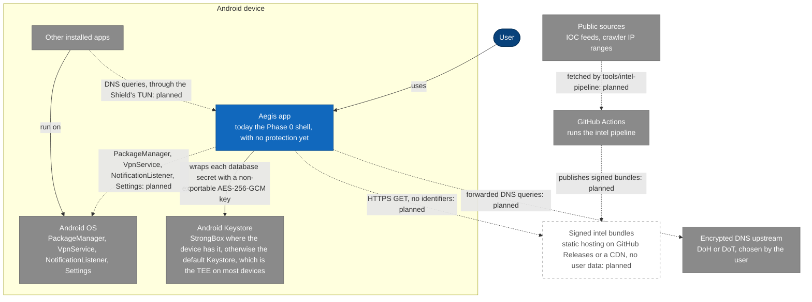
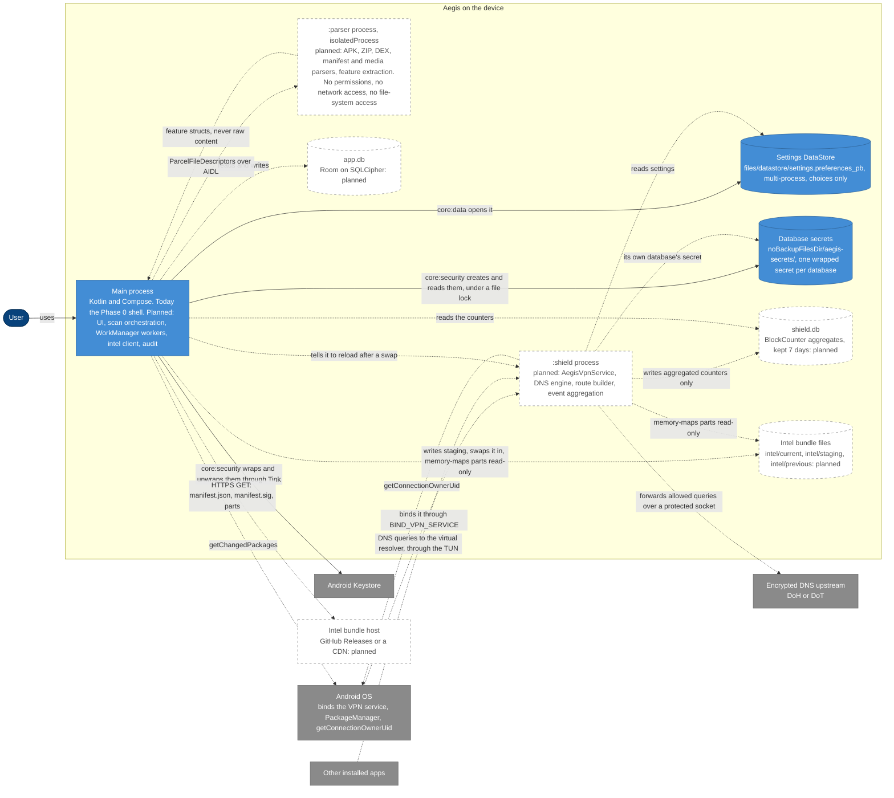
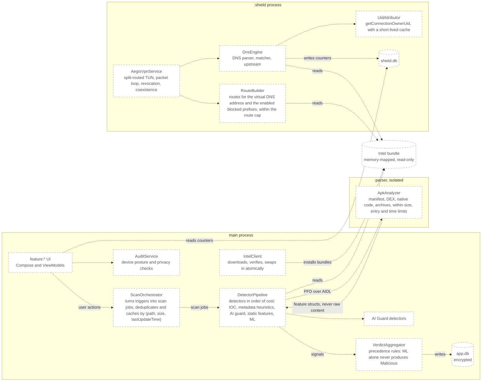
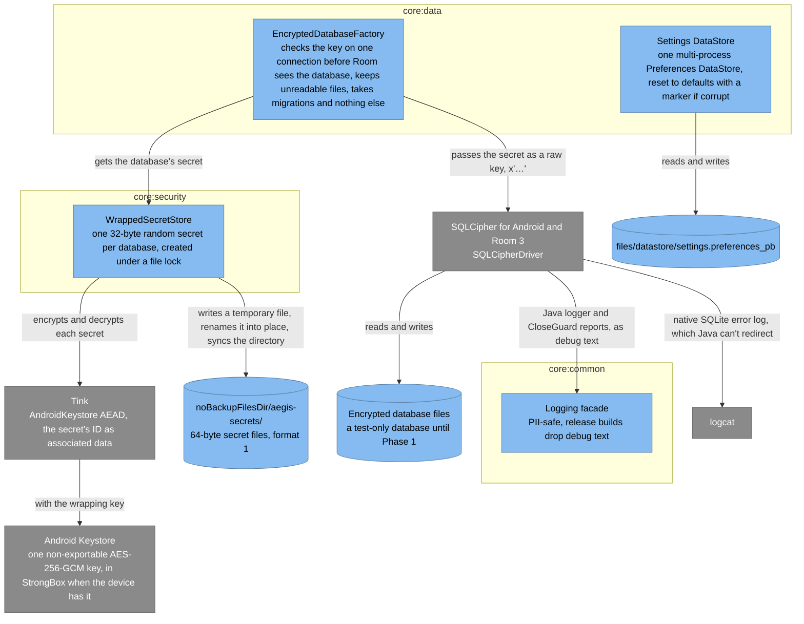
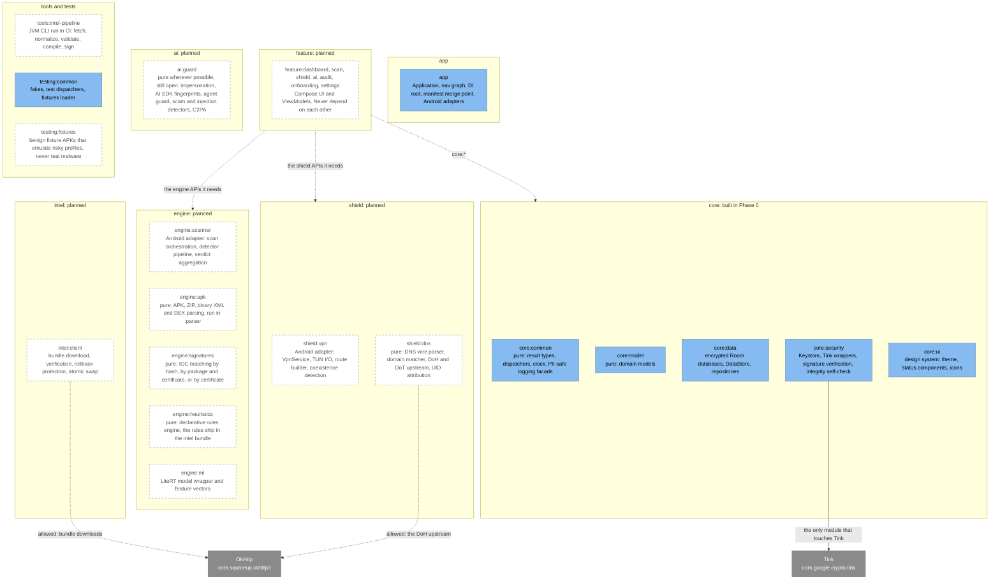

# C4 component and architecture diagrams

These diagrams show Aegis in the C4 model's views: the system and the
people and systems around it, its containers (the three processes and the
data between them), the components inside the processes, and the Gradle
modules. They were drawn at commit `ff54f4b` (Phase 0) from the design in
`docs/01-architecture.md`. At that commit only the Phase 0 foundation is
built, so most of what is drawn is planned: it is drawn dashed and
labelled "planned". View 4 draws the part that is built.

## Legend

| Style | Means |
| :- | :- |
| Dark blue, rounded | A person |
| Blue box | Part of Aegis that exists at `ff54f4b`: the system, a container or a component |
| Grey box | A system or library outside Aegis |
| Cylinder | Data on the device: a database, a file or a folder |
| White box with a dashed border | Planned: not built yet |
| Solid arrow | Uses, reads, writes or depends on, as labelled |
| Dotted arrow | Planned: not built yet |
| "pure" | Pure Kotlin/JVM: one of the six modules that `checkModuleGraph` keeps free of Android |

## 1. System context

Aegis on the device, with the user, the OS, the other apps, and the
services it will reach. At `ff54f4b` the app is the Phase 0 shell, which
offers no protection yet. Of the connections drawn, only the user's and the
Keystore's exist.

- **Key property:** no user data leaves the device. Aegis makes two kinds
  of outbound connection: it downloads signed bundles, and it forwards DNS
  queries that apps would have sent anyway, to an encrypted upstream that
  the user chooses (`docs/privacy.md`, "What leaves the device").
- The bundle host is static hosting and holds no user data.

## 2. Containers

The three processes and the data they keep on the device. Only the main
process exists at `ff54f4b`. The settings DataStore and the database
secrets are built in `core:data` and `core:security`.

- The main process and `:shield` share configuration through the settings
  DataStore and keep separate Room database files. `:shield` writes only
  aggregated counters, which the main process reads.
- Both processes memory-map intel bundle parts read-only.
- `:shield` is its own process so that the VPN survives UI crashes and
  stays small. `:parser` is isolated so that a crash or exploit while
  parsing hostile input is contained.
- Secrets are created under a file lock, because the main process and
  `:shield` can both start first.
- Settings aren't encrypted, so they hold only choices: booleans, numbers,
  and enum names. Anything that identifies the user's apps, sites, or
  content goes in an encrypted database.
- At `ff54f4b` the settings DataStore, the secret store and the database
  factory are built and tested, but no feature uses them yet.

## 3. Components of the processes

The planned components, by process, as `docs/01-architecture.md`
("Components") lists them. None is built yet.

- Detectors implement `Detector.evaluate(target, ctx)`, which returns a
  list of `Signal`s, so the AI guard and future detectors plug in without
  changing the orchestrator.
- `diagrams/scan-sequence.md`, `diagrams/dns-lookup-sequence.md` and
  `diagrams/intel-update-sequence.md` follow these components through
  their flows.

## 4. The Phase 0 foundation

What is built at `ff54f4b`: the secret store, the encrypted database
factory, and the settings DataStore, with the logging facade they report
through. `docs/01-architecture.md` ("Encryption") has every rule they
follow.

- The wrapping key needs no user authentication, because scheduled scans
  and the Shield open their databases while the screen is locked.
- A new key must pass an encrypt/decrypt round trip, or it's deleted. The
  key is created only while no secret is stored, because before Android 12
  the Keystore can report a key as missing when it's only failing.
- Nothing is deleted automatically. A secret that can't be read is
  reported as `KEY_LOST` or `UNREADABLE`, and a database that a key can't
  open is kept and reported as `Unreadable`. What the app does then is open
  decision #9 (`docs/00-overview.md`, "Open decisions").
- SQLite's native error log can include an error code, a database path,
  and the text of a failing SQL statement, so SQL never contains values:
  every value is a bound argument.

## 5. Modules

The Gradle modules by group, with the dependency rules drawn as arrows.
The seven modules of Phase 0 are built. The rest are added with
`/new-module` when their phase starts. `docs/01-architecture.md`
("Dependency rules") has every rule that `checkModuleGraph` enforces.

- Only `core:security` touches the Keystore and Tink. Only `intel:client`
  performs network I/O for bundles. `checkModuleGraph` fails any other
  module that reaches Tink or OkHttp except through an allowed module, or
  sees either on its compile classpath. The Keystore rule and the bundle
  network rule are reviewed by hand.
- A pure module never applies an Android plugin and never reaches an
  Android module or library on a production classpath.
- A built module may still hold only part of what its box lists.

## The modules

Every module in the layout, whether it exists at `ff54f4b`, and what kind
of module it is.

| Module | Path | Status | Kind | Holds |
| :- | :- | :- | :- | :- |
| `app` | `app` | Built (Phase 0) | Android application (`aegis.android.application`), an Android adapter | Application, nav graph, DI root, manifest merge point |
| `core:common` | `core/common` | Built (Phase 0) | Pure Kotlin/JVM (`aegis.jvm.engine`) | Result types, dispatchers, clock, PII-safe logging facade |
| `core:model` | `core/model` | Built (Phase 0) | Pure Kotlin/JVM (`aegis.jvm.engine`) | Domain models: `AppRecord`, `Finding`, `Verdict`, `Severity`, `IntelVersion`… |
| `core:data` | `core/data` | Built (Phase 0) | Android library | Room databases (encrypted), DataStore, repositories |
| `core:security` | `core/security` | Built (Phase 0) | Android library | Keystore, Tink wrappers, signature verification, integrity self-check |
| `core:ui` | `core/ui` | Built (Phase 0) | Android library with Compose | Design system: theme, status components, icons |
| `testing:common` | `testing/common` | Built (Phase 0) | Plain Kotlin/JVM (`aegis.jvm.library`) | Fakes, test dispatchers, fixtures loader |
| `engine:apk` | `engine/apk` | Planned | Pure Kotlin/JVM | APK, ZIP, binary XML and DEX parsing (runs in `:parser`) |
| `engine:signatures` | `engine/signatures` | Planned | Pure Kotlin/JVM | IOC matching by hash, by package and certificate, or by certificate |
| `engine:heuristics` | `engine/heuristics` | Planned | Pure Kotlin/JVM | Declarative rules engine (rules ship in the intel bundle) |
| `engine:ml` | `engine/ml` | Planned | Pure Kotlin/JVM wherever possible, not one of the six checked | LiteRT model wrapper and feature vectors |
| `engine:scanner` | `engine/scanner` | Planned | Android adapter | Scan orchestration, detector pipeline, verdict aggregation |
| `intel:client` | `intel/client` | Planned | Not stated yet | Bundle download, verification, rollback protection, atomic swap |
| `shield:vpn` | `shield/vpn` | Planned | Android adapter | `VpnService`, TUN I/O, route builder, coexistence detection |
| `shield:dns` | `shield/dns` | Planned | Pure Kotlin/JVM | DNS wire parser, domain matcher, upstream (DoH/DoT), UID attribution |
| `ai:guard` | `ai/guard` | Planned | Pure Kotlin/JVM wherever possible; whether it can be pure is still open | Impersonation, AI SDK fingerprints, agent guard, scam and injection detectors, C2PA |
| `feature:dashboard`, `feature:scan`, `feature:shield`, `feature:ai`, `feature:audit`, `feature:onboarding`, `feature:settings` | `feature/*` | Planned | Compose UI with ViewModels | The screens. Feature modules never depend on each other |
| `tools:intel-pipeline` | `tools/intel-pipeline` | Planned | JVM CLI run in CI | Fetch → normalize → validate → compile → sign |
| `testing:fixtures` | `testing/fixtures` | Planned | Fixture APKs, which will need their own convention plugin | Benign fixture APKs that emulate risky profiles (never real malware) |

## Sources

- `docs/01-architecture.md`: every section
- `settings.gradle.kts`, for the modules that exist
- `build-logic/convention/src/main/kotlin/io/github/jabbottiii/aegis/buildlogic/ModuleGraph.kt`,
  for the pure modules and the libraries only some modules may use
- the `build.gradle.kts` of each existing module, for its convention
  plugins
- `core/data/src/main/kotlin/io/github/jabbottiii/aegis/core/data/database/EncryptedDatabaseFactory.kt`,
  for the factory's use of the secret store
- `app/src/main/AndroidManifest.xml`, for the app shell's one process
