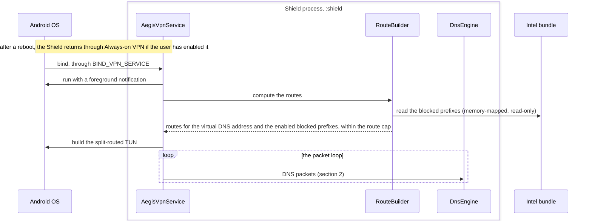
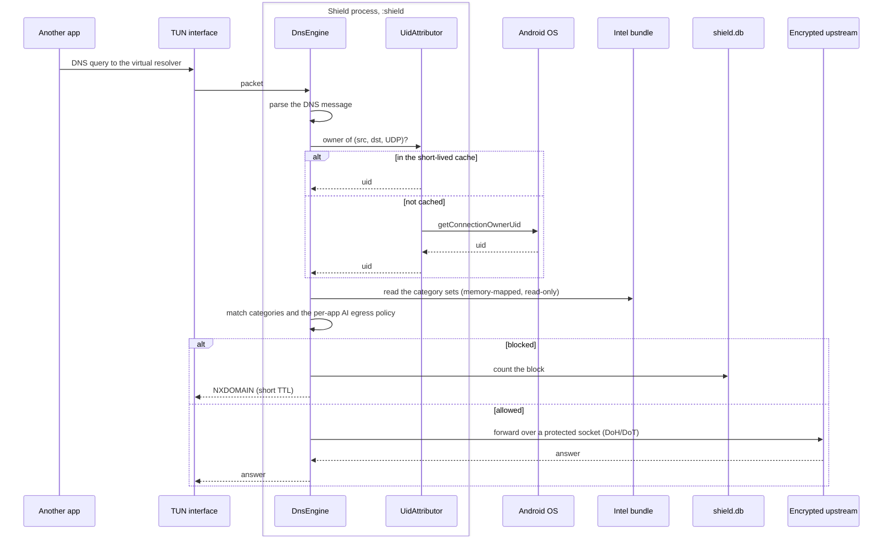
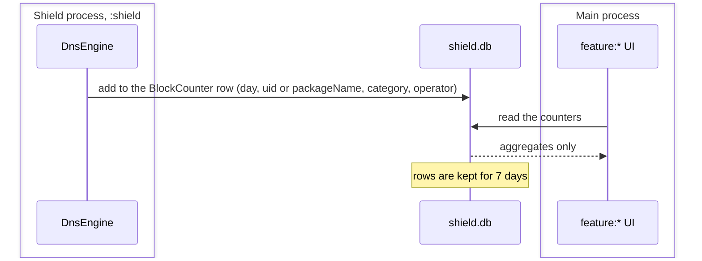

# DNS lookup sequence diagrams

These diagrams follow the Shield, Aegis's on-device VPN for network
protection: how it comes up in the `:shield` process, what happens to one
DNS query from another app, and how block counts reach the UI. They were
drawn at commit `ff54f4b` (Phase 0) from `docs/01-architecture.md`. None of
it is built yet: `shield:vpn`, `shield:dns` and the `:shield` process are
planned. The Shield sees DNS queries and never decrypts traffic (ADR-0002).

How to read them:

- A box is a process. A participant outside a box is the OS, another app,
  a file, or a service off the device.
- A solid arrow is a call or a message, and a dashed arrow its answer.
- The names are the planned components of `docs/01-architecture.md`
  ("Components"). The behavior and its limits are in
  `docs/features/network-protection.md`.

## 1. Bringing the Shield up

The system binds `AegisVpnService` through `BIND_VPN_SERVICE`. The service
runs in its own process, so that the VPN survives UI crashes and stays
small.

- **The foreground service type** is set in spike S1. `systemExempted`
  applies to VPN apps configured through *Settings › VPN* (Android 14 FGS
  rules). `specialUse`, with a Play justification, is used only if
  `systemExempted` is unavailable.
- **The route cap** that `RouteBuilder` enforces is part of the AI Crawler
  Shield's design (`docs/features/ai-crawler-shield.md`, "Design").
- **Revocation and coexistence** are handled by `AegisVpnService`
  (`docs/features/network-protection.md`, "Coexistence and settings
  interactions"). The Shield fails open with a visible alert and never
  silently breaks connectivity (`AGENTS.md` rule 9, FR-NET-09).
- **After an intel update** the main process tells `:shield` to reload
  (`diagrams/intel-update-sequence.md`).

## 2. One DNS lookup

An app's DNS query goes to the virtual resolver on the TUN. The DNS engine
finds the app that sent it, matches the name against the category sets and
the app's AI egress policy, and either answers NXDOMAIN or forwards the
query to the encrypted upstream that the user chose.

- **The upstream is the user's choice,** over DoH or DoT. The forwarded
  queries are ones the apps would have sent anyway, and they are one of the
  two kinds of connection that leave the device (`docs/privacy.md`, "What
  leaves the device").
- **OkHttp** is allowed in `shield:dns` for the DoH upstream, and in no
  other module but `intel:client` (`docs/01-architecture.md`, "Dependency
  rules").
- **The per-app AI egress policy** is an `AiEgressPolicy` row in `app.db`:
  package name, certificate digest, and a mode of allow, block or ask. The
  design doesn't yet say how `:shield` reads it, so the diagram draws only
  the match.
- **Blocklist categories** are declared in the bundle manifest, and the UI
  renders whatever categories the installed engine version supports.

## 3. Block counters

The `:shield` process writes only aggregated counters, and the main process
reads them. `shield.db` never holds a full query log.

- A `BlockCounter` row is a day, a uid or package name, a category, an
  operator, and a count (`docs/01-architecture.md`, "Data model";
  `docs/privacy.md`).

## Sources

- `docs/01-architecture.md`: "System context", "Processes", "Dependency
  rules", "Components", "Key flows" ("DNS lookup through the Shield"),
  "Data model", "Background execution", "Extensibility points"
- `AGENTS.md` rule 9, for the fail-open rule
