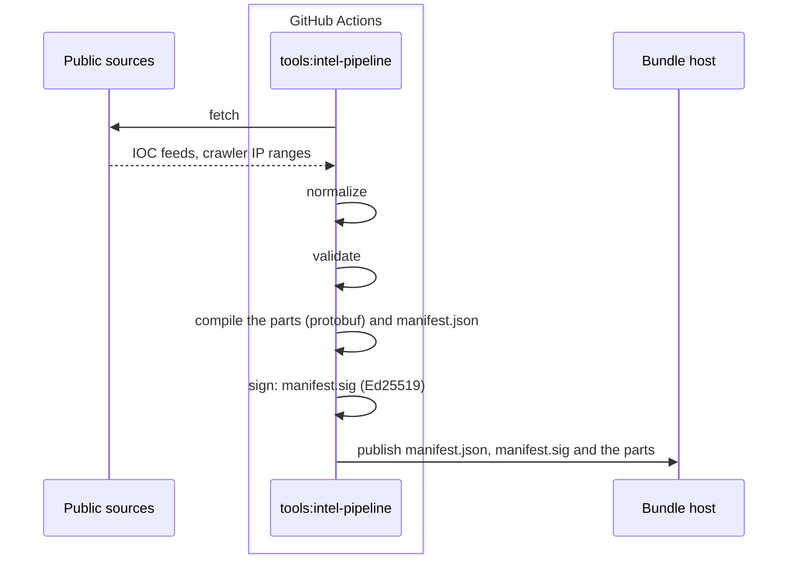
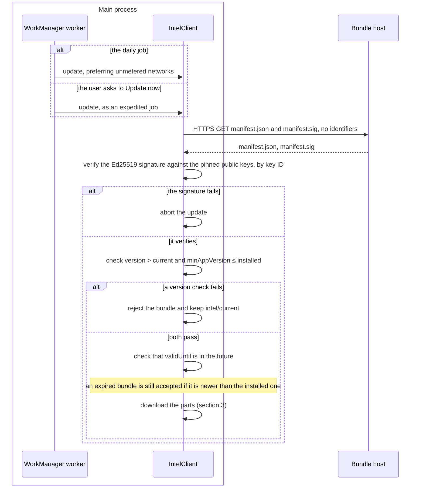
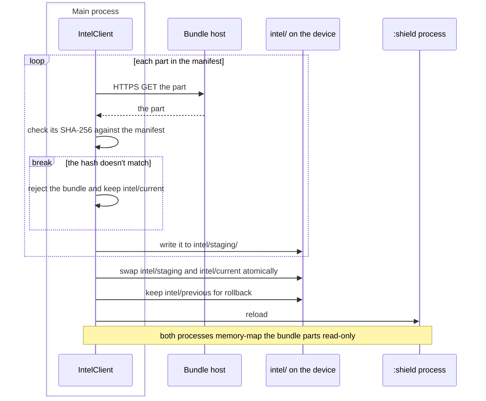

# Intel update sequence diagrams

These diagrams follow a threat-intel bundle from the public sources to the
device: how CI builds and signs it, how the device checks a new bundle, and
how it downloads the parts and swaps them in. They were drawn at commit
`ff54f4b` (Phase 0) from `docs/01-architecture.md`, with the failure
outcomes from ADR-0006 and `docs/requirements.md`. None of it is built
yet: `tools:intel-pipeline` and `intel:client` are planned. The bundle's
integrity comes from its Ed25519 signature, with pinned public keys,
monotonic versions, and expiry (ADR-0006).

How to read them:

- A box is a process, or GitHub Actions for the pipeline. A participant
  outside a box is a service off the device, or files on it.
- A solid arrow is a call or a message, and a dashed arrow its answer.
- A `break` block ends the sequence: the steps after it don't run.
- The names are the planned components of `docs/01-architecture.md`
  ("Components").

## 1. Building and signing a bundle

`tools:intel-pipeline` is a JVM CLI that runs in CI on GitHub Actions. It
turns the public sources into a signed bundle and publishes it to static
hosting, which holds no user data.

- **The bundle host** is GitHub Releases or a CDN.
- **The manifest** is JSON and the parts are protobuf, both through
  kotlinx.serialization. The manifest carries the bundle's `version`,
  `minAppVersion` and `validUntil`, each part's SHA-256, and the blocklist
  categories.
- **Rules and models** are data in the bundle, versioned with
  `minEngineVersion`.
- **The signing keys** and where they are kept are in ADR-0006
  (`docs/decisions.md`).

## 2. Checking a new bundle

A periodic WorkManager job runs once a day, preferring unmetered
networks, and an expedited job runs for a manual "Update now". The client
fetches the manifest and its signature, and checks both before it
downloads any part.

- **HTTPS, but no pinning.** The Network Security Config disables
  cleartext traffic and trusts only system CAs. Integrity comes from the
  signature rather than from the transport, so certificate pinning is not
  required.
- **Only `intel:client` does network I/O for bundles,** through OkHttp
  (`docs/01-architecture.md`, "Dependency rules").
- **Failures keep the installed bundle.** Any signature failure aborts the
  update. A version check or a part hash that fails rejects the bundle, and
  the installed bundle stays in use (ADR-0006, FR-INTEL-01, NFR-REL-02).

## 3. Downloading and swapping in

The client downloads each part, checks it against the manifest, and stages
it. Then it swaps the staged bundle in atomically, keeps the previous one
for rollback, and tells the `:shield` process to reload.

- **What is recorded:** `app.db` keeps an `IntelState` row for the current
  and the previous bundle: version, key ID, install time, `validUntil`, and
  the part hashes (`docs/01-architecture.md`, "Data model").
- **Who reads the bundle:** the detector pipeline in the main process, and
  the DNS engine and route builder in `:shield`.

## Sources

- `docs/01-architecture.md`: "System context", "Processes", "Module
  layout", "Dependency rules", "Components", "Key flows" ("Intel update"),
  "Data model", "Background execution", "Security architecture of Aegis
  itself", "Technology stack", "Extensibility points"
- `docs/decisions.md`: ADR-0006, for rejecting `version ≤ installed`
- `docs/requirements.md`: FR-INTEL-01, for rejecting a bundle that fails
  hash verification, and NFR-REL-02, for keeping the last good bundle
