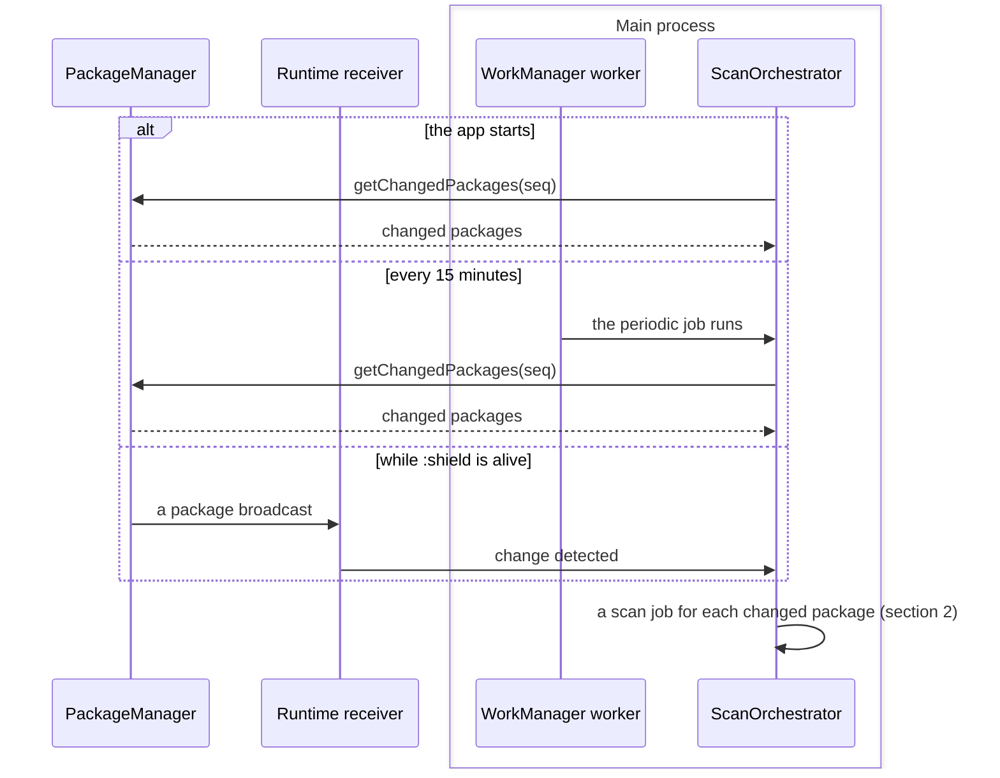
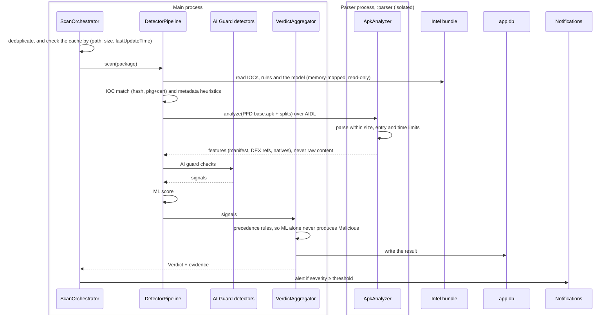
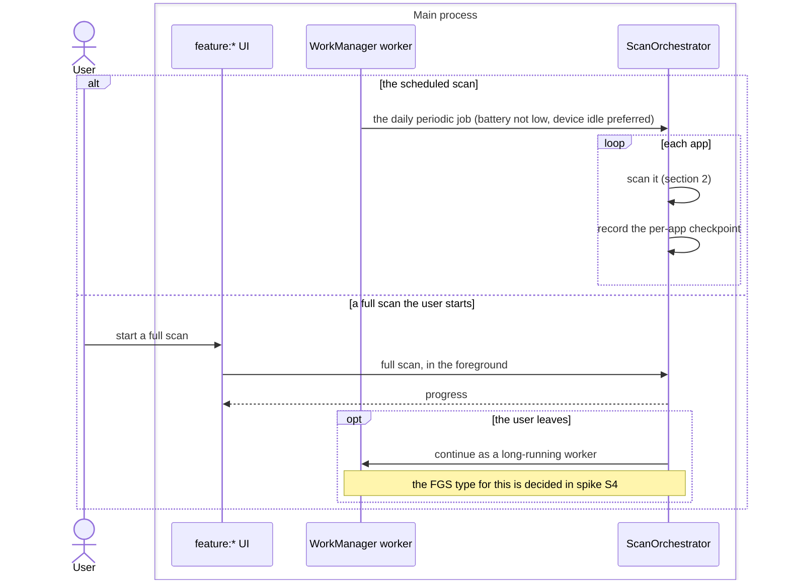

# Scan sequence diagrams

These diagrams follow a malware scan through the design: how Aegis notices
that an app was installed or updated, how it scans one app across the main
process and the isolated `:parser` process, and how scheduled and
user-started full scans run. They were drawn at commit `ff54f4b` (Phase 0)
from `docs/01-architecture.md`. None of it is built yet: the `engine:*`
modules, `ai:guard`, the `feature:*` modules and the `:parser` process are
all planned.

How to read them:

- A box is a process. A participant outside a box is the OS, a file, or
  another part of the device.
- A solid arrow is a call or a message, and a dashed arrow its answer.
- The names are the planned components of `docs/01-architecture.md`
  ("Components"). The detection rules themselves are in
  `docs/features/malware-detection.md`.

## 1. Noticing a package change

The orchestrator learns about changed packages in three ways. It calls
`getChangedPackages(seq)` when the app starts and from a WorkManager job
every 15 minutes, and a runtime-registered receiver hears package
broadcasts while `:shield` is alive. Manifest-declared receivers for
implicit package broadcasts are not dependable on API 26+.

- The receiver is registered at runtime while `:shield` is alive.
  `docs/01-architecture.md` doesn't yet say which process registers it or
  how it reaches the orchestrator, so the diagram leaves it outside the
  boxes.
- The orchestrator also turns a schedule and a user action into scan jobs
  (section 3), and a new file too. A `Finding`'s target can be a file URI,
  but the design doesn't draw the new-file flow yet.

## 2. Scanning one app

One scan job, from the orchestrator through the detectors to a verdict and
an alert. The parser runs in the isolated `:parser` process with no
permissions, no network access, and no file-system access. Input reaches it
as `ParcelFileDescriptor`s over AIDL, so a crash or exploit while parsing
stays there.

- **The order of the detectors.** `docs/01-architecture.md` gives the
  pipeline's order of cost as IOC → metadata heuristics → AI guard → static
  features → ML ("Components"), but its flow "New app installed" runs the
  AI guard checks after the parser returns the static features. This
  diagram follows the flow. `docs/features/malware-detection.md`
  ("Detection pipeline") is the spec.
- **The parser's limits:** max entries, max uncompressed size, a
  compression-ratio guard against zip bombs, and timeouts.
- **Detectors plug in.** Each implements
  `Detector { suspend fun evaluate(target: ScanTarget, ctx: DetectionContext): List<Signal> }`,
  so the AI guard and future detectors join the pipeline without changes
  to the orchestrator.
- **IOCs, rules and models come from the intel bundle.** Rules and models
  are versioned with `minEngineVersion` (`diagrams/intel-update-sequence.md`).
- **What is stored:** `app.db` keeps `AppRecord`, `Finding` and
  `ScanSession` rows, among others (`docs/01-architecture.md`, "Data
  model").

## 3. Scheduled and full scans

The daily scheduled scan runs as a WorkManager job and can resume from a
per-app checkpoint. A full scan the user starts runs in the foreground with
progress, and moves to a WorkManager long-running worker if the user
leaves.

- `dataSync` does not describe the background continuation, so the likely
  FGS type is `specialUse` with a Play justification. Spike S4 decides it.

## Sources

- `docs/01-architecture.md`: "Processes", "Components", "Key flows" ("New
  app installed"), "Data model", "Background execution", "Security
  architecture of Aegis itself", "Extensibility points"
