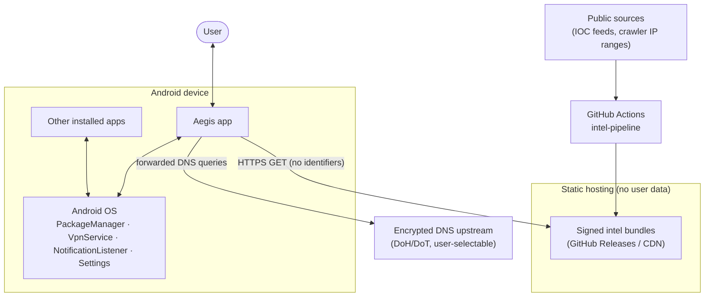
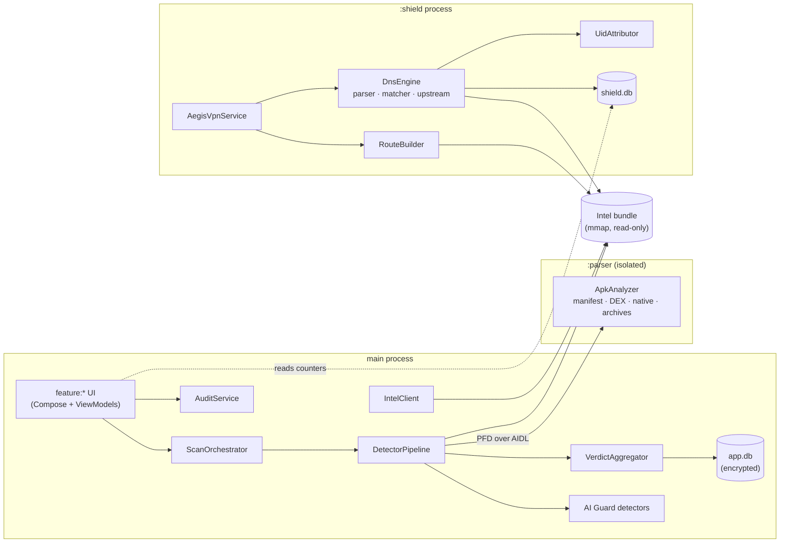
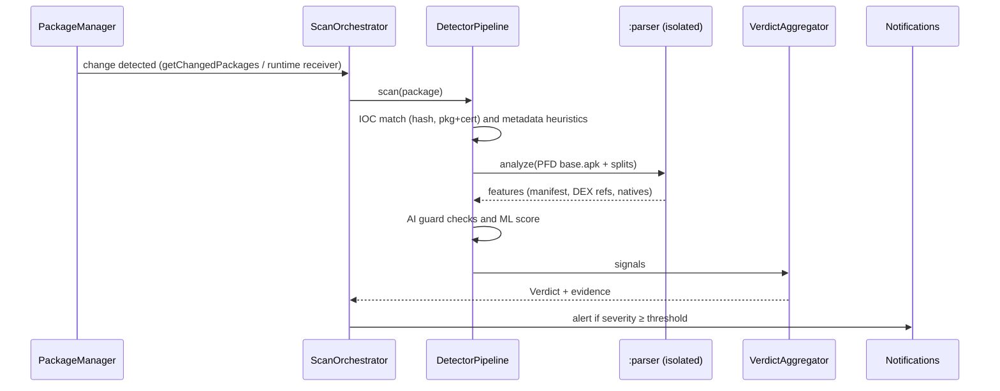
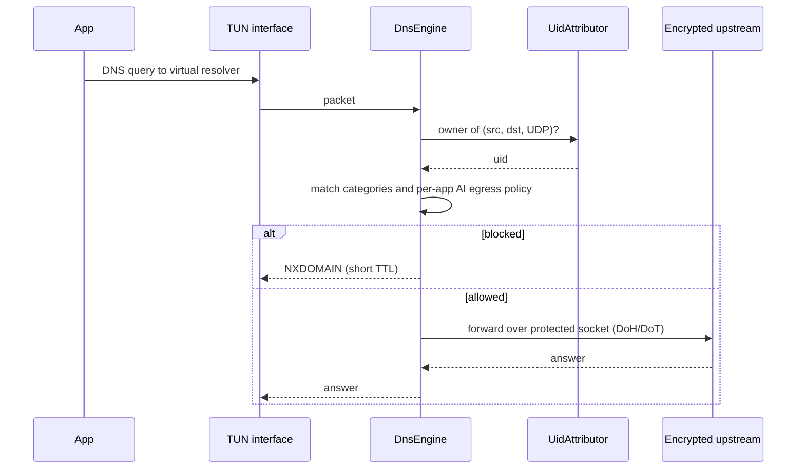

# Aegis Architecture

*Last updated: 2026-10-31 · Status: Proposed (validate with Phase 0 spikes)*

Related: [Plan](PLAN.md) · [Requirements](REQUIREMENTS.md) · [Threat model](THREAT_MODEL.md) · [ADRs](adr/README.md)

---

## 1. System context



**Key property:** no user data leaves the device. Aegis makes two kinds of outbound
connection: (1) it downloads signed bundles, and (2) it forwards DNS queries that apps would
have sent anyway. The forwarded queries go to an encrypted upstream that the user chooses
([PRIVACY](PRIVACY.md#what-leaves-the-device)).

## 2. Process model

Three processes keep untrusted input and long-running networking away from the UI:

| Process | Contents | Why |
|---|---|---|
| **main** | UI (Compose), scan orchestration, WorkManager workers, intel client, audit | Normal app lifecycle |
| **`:shield`** | `AegisVpnService`, DNS engine, route builder, event aggregation | The VPN survives UI crashes and stays small. The system binds it through `BIND_VPN_SERVICE`. |
| **`:parser`** (`android:isolatedProcess="true"`) | APK/ZIP/DEX/manifest/media parsers, feature extraction | It handles hostile input with **no permissions**, no network access, and no file-system access. Input arrives as `ParcelFileDescriptor`s over AIDL. A crash or exploit there is contained. |

The main process and `:shield` share configuration through DataStore and keep separate Room
database files. The `:shield` process writes only aggregated counters, which the main process reads.
Both processes memory-map intel bundle parts read-only.

## 3. Module layout

```
Aegis/
├── app/                      # Application, nav graph, DI root, manifest merge point
├── build-logic/              # Gradle convention plugins (android-library, compose, engine, test)
├── core/
│   ├── common/               # Result types, dispatchers, clock, PII-safe logging facade
│   ├── model/                # Domain models: AppRecord, Finding, Verdict, Severity, IntelVersion…
│   ├── data/                 # Room DBs (encrypted), DataStore, repositories
│   ├── security/             # Keystore, Tink wrappers, signature verification, integrity self-check
│   └── ui/                   # Design system: theme, status components, icons
├── engine/
│   ├── apk/                  # APK/ZIP/binary-XML/DEX parsing (runs in :parser)
│   ├── signatures/           # Hash / package+cert / cert IOC matching
│   ├── heuristics/           # Declarative rules engine (rules ship in intel bundle)
│   ├── ml/                   # LiteRT model wrapper + feature vectors
│   └── scanner/              # Scan orchestration, detector pipeline, verdict aggregation
├── intel/
│   └── client/               # Bundle download, verification, rollback protection, atomic swap
├── shield/
│   ├── vpn/                  # VpnService, TUN I/O, route builder, coexistence detection
│   └── dns/                  # DNS wire parser, domain matcher, upstream (DoH/DoT), UID attribution
├── ai/
│   └── guard/                # Impersonation, AI SDK fingerprints, agent guard, scam & injection detectors, C2PA
├── feature/
│   ├── dashboard/  scan/  shield/  ai/  audit/  onboarding/  settings/
├── tools/
│   └── intel-pipeline/       # JVM CLI run in CI: fetch → normalize → validate → compile → sign
└── testing/
    ├── common/               # Fakes, test dispatchers, fixtures loader
    └── fixtures/             # Benign fixture APKs that emulate risky profiles (never real malware)
```

**Dependency rules** (enforced by convention plugins and a module-graph check in CI):

- `feature:*` → `core:*`, plus the engine and shield APIs it needs. Feature modules never depend on each other.
- `engine:*`, `shield:dns`, and `ai:guard` are **pure Kotlin/JVM wherever possible** (no Android framework), which keeps them fast to unit-test and fuzz. Android adapters live in `engine:scanner`, `shield:vpn`, and `app`.
- Only `core:security` touches the Keystore and Tink. Only `intel:client` performs network I/O for bundles.

## 4. Component overview



| Component | Responsibility |
|---|---|
| `ScanOrchestrator` | Turns triggers (package change, schedule, user action, new file) into scan jobs. Deduplicates and caches by `(path, size, lastUpdateTime)`. |
| `DetectorPipeline` | Runs detectors in order of cost: IOC → metadata heuristics → AI guard → static features → ML ([spec](features/malware-detection.md#3-detection-pipeline)). |
| `VerdictAggregator` | Applies the precedence rules that combine detector signals into one verdict, so that ML on its own can never produce *Malicious*. |
| `ApkAnalyzer` | Parses untrusted APKs inside the isolated process with size, entry, and time limits. Returns feature structs, never raw content. |
| `AuditService` | Runs the device posture and privacy checks ([spec](features/device-security-audit.md)). |
| `IntelClient` | Downloads bundles, verifies them, and swaps them in atomically ([ADR-0006](adr/0006-signed-threat-intel-updates.md)). |
| `AegisVpnService` | Builds the split-routed TUN, runs the packet loop, and handles revocation and coexistence ([spec](features/network-protection.md)). |
| `RouteBuilder` | Computes routes for the virtual DNS address and the enabled blocked prefixes, enforcing the route cap ([AI Crawler Shield](features/ai-crawler-shield.md#5-design)). |
| `DnsEngine` | Parses DNS messages, matches them against the category sets and per-app egress policy, then answers NXDOMAIN or forwards the query upstream. |
| `UidAttributor` | Maps a flow to an app UID with `getConnectionOwnerUid`, using a short-lived cache. |

## 5. Key flows

### 5.1 New app installed



### 5.2 DNS lookup through the Shield



### 5.3 Intel update

1. A WorkManager job runs once a day, preferring unmetered networks. It fetches `manifest.json` and `manifest.sig` over HTTPS.
2. It verifies the Ed25519 signature against the pinned public keys (by key ID). Any failure aborts the update.
3. It checks `version > current`, `minAppVersion ≤ installed`, and that `validUntil` is in the future (an expired bundle is still accepted if it is newer than the installed one).
4. It downloads each part and checks the SHA-256 against the manifest, then writes to `intel/staging/`.
5. It swaps `intel/staging` and `intel/current` atomically, keeps `intel/previous` for rollback, and notifies the `:shield` process to reload.

## 6. Data model (main `app.db`)

| Entity | Key fields | Retention |
|---|---|---|
| `AppRecord` | packageName, versionCode, certSha256[], installer, firstSeen, lastScannedAt, contentFingerprint | While installed |
| `Finding` | id, target (pkg or file URI), verdict, severity, detectorId, ruleId, evidence (JSON), status (open, resolved, trusted), createdAt | 90 days after resolution |
| `TrustRule` | packageName, certSha256, createdAt, reason | Until the user removes it |
| `ScanSession` | id, trigger, startedAt, finishedAt, counts | 90 days |
| `AuditResult` | checkId, state, observedAt | Latest only |
| `IntelState` | version, keyId, installedAt, validUntil, partHashes | Current and previous |
| `QuarantineItem` | id, originalName, sha256, encryptedPath, createdAt | Until deleted or restored |
| `AiEgressPolicy` | packageName, certSha256, mode (allow, block, ask) | Until changed |

`shield.db` holds `BlockCounter` rows: day, uid or packageName, category, operator, count. It
keeps aggregates only, never full query logs, and retains them for 7 days ([PRIVACY](PRIVACY.md)).

**Encryption:** Room is backed by SQLCipher. The database key is generated randomly, wrapped by an
Android Keystore AES-GCM key (with StrongBox where available) using Tink, and stored in the app
sandbox. `allowBackup="false"`, and `dataExtractionRules` exclude every domain.

## 7. Background execution

| Work | Mechanism | Notes |
|---|---|---|
| Shield | `VpnService`, system-bound, with a foreground notification | The FGS type is set in spike S1. `systemExempted` applies to VPN apps configured through *Settings › VPN* (Android 14 FGS rules). Use `specialUse` with a Play justification only if `systemExempted` is unavailable. |
| Package change detection | `getChangedPackages(seq)` on app start, every 15 min via WorkManager, and from a runtime-registered receiver while `:shield` is alive | Manifest-declared receivers for implicit package broadcasts are not dependable on API 26+. |
| Scheduled scan | Periodic WorkManager job (daily, battery not low, device idle preferred) | Resumable, with a per-app checkpoint |
| User-initiated full scan | Runs in the foreground with progress. If the user leaves, it continues as a WorkManager long-running worker. | The FGS type for the background continuation is decided in S4. `dataSync` does not describe this work, so the likely choice is `specialUse` with a Play justification. |
| Intel update | Periodic WorkManager job (daily) plus an expedited job for manual "Update now" | |
| Agent guard | Re-check on app resume, after a package change, and on a periodic job. Also an `AccessibilityManager` state listener while the process is alive. | |
| Boot | `RECEIVE_BOOT_COMPLETED` re-schedules work. The Shield returns through Always-on VPN if the user has enabled it. | |

Aegis does **not** request `REQUEST_IGNORE_BATTERY_OPTIMIZATIONS`. Play restricts that permission.
Instead, Aegis opens the system battery settings with guidance for each OEM.

## 8. Security architecture of Aegis itself

- **Untrusted input isolation:** parsing runs in `:parser` with hard limits (max entries, max uncompressed size, compression-ratio guard against zip bombs, and timeouts).
- **Integrity of updates:** Ed25519 signatures with pinned public keys, monotonic versions, and expiry ([ADR-0006](adr/0006-signed-threat-intel-updates.md)).
- **Network:** the Network Security Config disables cleartext traffic and trusts only system CAs. Bundle hosts are fetched over HTTPS. Integrity comes from the signature rather than from the transport, so certificate pinning is not required.
- **Exported surface:** activities that accept share or VIEW intents validate MIME type and size and copy content into the sandbox before parsing. The VPN and notification-listener services are protected by their system bind permissions. Nothing else is exported.
- **Self-protection:** a startup check verifies the signing certificate against the expected digest. Sensitive screens use `FLAG_SECURE` and `setAccessibilityDataSensitive` (API 34+). Aegis warns the user when an unknown accessibility service is enabled.
- **Secrets:** there are no API keys in the APK. Optional features that need keys (such as Web Risk) require a backend proxy (open decision #4).

## 9. Technology stack (proposed)

Pin exact versions in `gradle/libs.versions.toml` at scaffold time. Use current stable releases and avoid alphas in `engine:*`.

| Concern | Choice | Notes |
|---|---|---|
| Language | Kotlin 2.x (K2), coroutines, Flow | Explicit API mode in engine modules |
| UI | Jetpack Compose, Material 3, Navigation Compose | |
| DI | Hilt (KSP) | |
| Persistence | Room + SQLCipher for Android, DataStore | |
| Background | WorkManager | |
| Crypto | Google Tink (Ed25519 verify, AEAD), Android Keystore | |
| Networking | OkHttp (bundle downloads, DoH) | No other HTTP stacks |
| Serialization | kotlinx.serialization (JSON manifest, protobuf parts) | |
| APK/DEX parsing | dexlib2 (candidate) or a custom minimal parser | Decided in spike S4. Check the license against the allowlist. |
| On-device ML | LiteRT (formerly TensorFlow Lite) | Models are delivered in signed bundles |
| QR | CameraX + ML Kit barcode scanning (bundled model) | A `foss` flavor would use ZXing (open decision #3) |
| Provenance | `c2pa-android` (Kotlin wrapper over the C2PA C API, minSdk 28) | Size impact measured in spike S6 |
| Testing | JUnit, Turbine, MockK, Robolectric, Compose UI test, Macrobenchmark, Jazzer (fuzzing) | See [TESTING](TESTING.md) |
| Static analysis | Android Lint, detekt, ktlint, CodeQL (Java/Kotlin) | See [DEVELOPMENT](DEVELOPMENT.md#ci-gates) |

## 10. Extensibility points

- **Detectors** implement `Detector { suspend fun evaluate(target: ScanTarget, ctx: DetectionContext): List<Signal> }`, which lets the AI guard and future detectors plug in without changing the orchestrator.
- **Rules and models** are data in the intel bundle, versioned with `minEngineVersion`.
- **Blocklist categories** are declared in the bundle manifest. The UI renders whatever categories the installed engine version supports.
