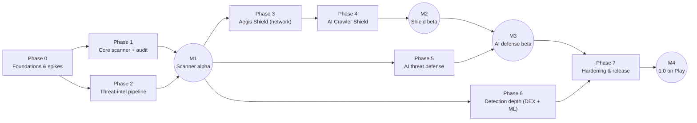

# Aegis Implementation Plan

*Last updated: 2026-11-01 · Status: Draft for owner review. Phase 0 in progress.*

This plan takes Aegis from an empty repository to a 1.0 release on Google Play. Work is
sequenced so the highest-risk platform questions are answered first (Phase 0 spikes), so that a
usable scanner exists early (M1), and so that every later feature builds on a tested core.

Related: [Requirements](REQUIREMENTS.md) · [Architecture](ARCHITECTURE.md) · [Threat model](THREAT_MODEL.md)

---

## 1. Goals and non-goals

**Goals for 1.0**

1. Detect malicious, stalkerware, and potentially unwanted apps (PUA) on install, on update, on demand, and on a schedule, with a low false-positive rate.
2. Block known malicious domains device-wide with an on-device DNS filter, without decrypting traffic.
3. Defend against AI-era threats that a non-root Android app can realistically address: fake AI apps, AI-written scams, prompt injection, over-privileged AI agents, unverified synthetic media, and AI data egress.
4. Provide an **AI Crawler Shield** toggle that blocks known AI crawler and agent networks and describes its coverage honestly.
5. Pass Google Play review on the first submission, with every sensitive permission declared and justified.

**Non-goals for 1.0** (revisit after launch)

- Root-only features, such as an inbound firewall or `iptables` rules.
- TLS interception or content inspection of HTTPS ([ADR-0002](adr/0002-no-tls-interception.md)).
- Anti-theft, remote wipe, app lock, VPN-to-remote-server, or call recording.
- iOS, Wear OS, TV, or enterprise MDM integration.
- A cloud backend that stores user data. Static hosting for signed intel bundles is in scope.

## 2. Delivery overview

| Phase | Focus | Rough effort* | Exit milestone |
|---|---|---|---|
| 0 | Project scaffold, CI, core security plumbing, technical spikes S1–S7 | 3 wks | M0 Foundations ready |
| 1 | App inventory, IOC matching, metadata heuristics, scan UX, device audit | 5 wks | M1 (with P2) |
| 2 | Intel pipeline (CI), bundle format, signing, update client | 3 wks | M1 Scanner alpha |
| 3 | Local VPN, DNS filter, per-app attribution, link/QR checker, network checks | 5 wks | M2 (with P4) |
| 4 | AI Crawler Shield: range ingestion, routing, AI egress control, exposure check | 2.5 wks | M2 Shield beta |
| 5 | AI threat defense features | 6 wks | M3 AI defense beta |
| 6 | DEX static analysis, rules engine, ML classifier, false-positive (FP) corpus | 5 wks | Feeds M4 |
| 7 | MASVS review, performance and battery work, Play declarations, closed testing | 4 wks | M4 1.0 |

\*These estimates are rough and assume **one developer working roughly full time** (about 33 weeks in total).
They are a planning assumption, not a commitment. Scale them for part-time work and re-estimate after the Phase 0 spikes.
Phases 5 and 6 can run in parallel if a second contributor joins.

---

## 3. Phases in detail

### Phase 0: Foundations and technical spikes (≈3 weeks)

**Build and tooling**
- Set up a multi-module Gradle (Kotlin DSL) project with a version catalog (`gradle/libs.versions.toml`) and convention plugins in `build-logic/`. The module layout is in [ARCHITECTURE § Modules](ARCHITECTURE.md#3-module-layout).
- Run CI on GitHub Actions: assemble, unit tests, Android Lint, detekt, ktlint, Gradle dependency verification, and a dependency license allowlist check. Details are in [DEVELOPMENT](DEVELOPMENT.md#ci-gates).
- Add a design system in `core:ui` with theme, typography, and status components, plus Compose previews.
- Wire up DI (Hilt), coroutines dispatchers, and a logging facade that strips PII by construction.
- Build an encrypted Room database and a DataStore for settings. Exclude both from backup and device transfer.

**Technical spikes.** Each one is time-boxed. Write up the outcome as an ADR or a spec update.

| ID | Question to answer | Blocks | Pass criteria |
|---|---|---|---|
| **S1** | Can a split-routed `VpnService` intercept DNS reliably, including the TCP fallback? What are the latency and battery cost, which foreground-service type applies, and how does it behave with *Private DNS* and *Always-on / Block connections without VPN*? How expensive is per-packet `getConnectionOwnerUid`? | P3, P4 | p95 added DNS latency ≤ 5 ms. No connectivity loss across 24 h on 3 OEMs. Documented behavior matrix. |
| **S2** | How many routes can the VPN install (1k / 5k / 10k prefixes) on low-end and OEM devices, and what are the apply time and memory cost? | P4 | Safe route cap chosen and documented. |
| **S3** | When a crawler prefix is routed into the TUN, are **replies** from on-device listening sockets captured? In other words, is any "inbound" claim possible without root? | P4 UI copy | Outcome documented. The UI may claim inbound protection **only** if capture is reproducible on every matrix device. |
| **S4** | APK and DEX analysis throughput: dexlib2 vs. a custom parser, hashing speed, peak memory on APKs of 150 MB or more, and running inside an `isolatedProcess` service | P1, P6 | p95 scan of a 100 MB APK ≤ 10 s on a mid-range device. Peak memory ≤ 150 MB. |
| **S5** | LiteRT model cost (size, latency) for the APK classifier and a small scam-text classifier | P5, P6 | APK model ≤ 5 MB and ≤ 50 ms per app. Text model ≤ 10 MB and ≤ 30 ms per message. |
| **S6** | `c2pa-android` integration: APK size per ABI, and validation of the C2PA sample corpus | P5 | Per-ABI size delta documented. Reads and validates the sample manifests. |
| **S7** | Notification-listener reliability on Pixel, Samsung, and Xiaomi (background kills), plus the Android 15+ sensitive-notification redaction behavior | P5 | Delivery rate ≥ 99% over 48 h on each OEM, or a documented mitigation. |

**Exit (M0):** a clean CI run on `main`, an empty app with the design system, spike write-ups merged, and the ADRs updated to *Accepted* or *Rejected*.

### Phase 1: Core scanner and device audit (≈5 weeks)

- **App inventory:** packages, versions, signing certificate SHA-256 digests (`signingInfo`), installer source (`getInstallSourceInfo` on API 30+), requested and granted permissions, and privileged components (accessibility services, notification listeners, device admin).
- **Change detection:** `PackageManager.getChangedPackages()` with a stored sequence number. It runs on app start, on a periodic WorkManager job, and from a context-registered package receiver while the Shield service is running. Do not rely on manifest-declared implicit package broadcasts, which have been restricted since API 26. Verify each action against the exemption list during implementation.
- **IOC matching** against the bundled intel: APK SHA-256, package name plus certificate pairs, and stalkerware indicators.
- **Metadata heuristics v1:** permission-combination rules (for example, accessibility + overlay + SMS/notification access + sideloaded), debuggable release builds, disabled launcher entries, and very old targetSdk with dangerous permissions.
- **Scan UX:** dashboard status, scan progress, findings with evidence and plain-language explanations, and remediation through an uninstall prompt (`PackageInstaller.uninstall`, which shows a system confirmation), a shortcut to app settings, or *Trust this app*. Trust is pinned to the signing certificate.
- **Stalkerware safety flow:** warn before any removal and link to support resources ([spec](features/device-security-audit.md#4-stalkerware-safety-flow)).
- **Device security audit v1** ([spec](features/device-security-audit.md)).
- **File scan v1:** single-file scan through the system picker and through share-to-Aegis.

### Phase 2: Threat-intel pipeline and signed updates (≈3 weeks, parallel with P1)

- `tools/intel-pipeline/` is a JVM CLI that runs in GitHub Actions. It fetches each source in [DATA_SOURCES](DATA_SOURCES.md), then normalizes, validates, and compiles the bundle parts and writes a manifest.
- Validation gates: schema checks, prefix-breadth limits, canary allowlists (popular domains and IP ranges that must never be blocked), and maximum churn per release. A diff report is attached to each build.
- Two-tier Ed25519 signing: an offline root key that is pinned in the app delegates a short-lived online key, which CI uses inside a protected environment. No private key lives in the repository ([ADR-0006](adr/0006-signed-threat-intel-updates.md)).
- The app-side `intel:client` handles daily checks (preferring unmetered networks), signature and hash verification, rollback protection with monotonic versions, expiry warnings, an atomic swap, and keeps the last good bundle.
- A baseline bundle ships inside the APK so that protection works offline from first launch.

**Exit (M1 Scanner alpha):** the scanner detects the AMTSO Android test artifacts and fixture apps, the intel update works end to end on a test channel, and internal testing runs on the Play *internal testing* track.

### Phase 3: Aegis Shield, network protection (≈5 weeks)

- `VpnService` in split-routing mode. Only the virtual DNS resolver address and opt-in blocked prefixes enter the tunnel ([ADR-0003](adr/0003-local-vpn-split-routing.md)).
- DNS filter: a UDP/TCP DNS parser, a category blocklist (malware, phishing, scam, stalkerware C2), NXDOMAIN responses, and an encrypted upstream (DoH/DoT) with network-resolver fallback.
- Per-app attribution with `ConnectivityManager.getConnectionOwnerUid` (API 29+, available to the active VPN app), plus rate-limited block notifications.
- Coexistence: detect another active VPN, Private DNS in strict mode, and Always-on settings, and explain each to the user.
- Fail-open with a visible alert if the filter engine fails, so that users do not lose connectivity silently.
- Link checker (share target), QR scanner (CameraX + bundled barcode model), and network checks: open Wi-Fi, captive portal, and user-installed CA certificates.
- Play VpnService declaration assets: the prominent-disclosure screen and the demo videos ([PERMISSIONS_AND_POLICY](PERMISSIONS_AND_POLICY.md#3-vpnservice)).

### Phase 4: AI Crawler Shield (≈2.5 weeks)

See the [feature spec](features/ai-crawler-shield.md). Summary:

- Ingest the published crawler and fetcher IP ranges (OpenAI, Perplexity, Anthropic, Common Crawl; Apple and Google in Strict mode), aggregate the CIDRs, and enforce the route cap from S2.
- Master toggle (default **off**) plus sub-options: *Standard*, *Strict*, and *AI service egress control*. The egress control is per-app, with allow and ask modes.
- Exposure check: whether the device has a globally routable IPv6 address, whether it is on open Wi-Fi, and whether wireless debugging is on (where readable).
- UI copy is driven by spike S3 results. No inbound claims are made unless they have been verified.

**Exit (M2 Shield beta):** the closed testing track. Battery drain attributable to the Shield is ≤ 2% per day on the device matrix.

### Phase 5: AI threat defense (≈6 weeks)

See the [feature spec](features/ai-threat-defense.md). In priority order:

1. AI app impersonation detection (an official-app registry matched by package and certificate, plus lookalike labels and icons).
2. AI access audit (AI SDK fingerprints combined with sensitive capabilities) and **agent guard** alerts when an app newly gains accessibility or notification-listener access.
3. Scam and smishing detection through the opt-in notification listener (rules, URL reputation, and the on-device classifier).
4. Prompt-injection and hidden-text scanner for shared text, links, and QR payloads.
5. Synthetic-media provenance check (C2PA plus IPTC digital-source-type metadata).
6. Voice-clone scam safeguards: a family safe-word helper and a guided caller-verification checklist.

### Phase 6: Detection depth (≈5 weeks)

- DEX static features run inside the isolated parser process: API references, dynamic code loading, embedded payloads, and known packers.
- A declarative heuristic rules engine whose rules ship in the intel bundle, so they can be updated without an app release.
- ML classifier: offline training pipeline (kept outside this repo or in `tools/ml/`, with dataset terms respected), a LiteRT model shipped in the signed bundle, and thresholds calibrated against the benign corpus.
- False-positive corpus: the top benign apps evaluated on every model or rule change ([TESTING](TESTING.md#3-detection-quality)).

### Phase 7: Hardening, compliance, and release (≈4 weeks)

- An OWASP MASVS review and the MASTG test cases, fuzzing of every parser (APK, DEX, DNS, QR payloads), and tamper testing.
- Performance and battery tuning against the [NFR budgets](REQUIREMENTS.md#3-non-functional-requirements), plus a baseline profile.
- An *Open-source licenses* screen, generated from licensee's `artifacts.json`. BSD-3-Clause requires the copyright notice, conditions, and disclaimer in binary distributions, and Apache-2.0 requires its license text and any NOTICE contents. Cover what licensee can't see too: SQLCipher bundles SQLite (public domain), libtomcrypt, and a Java layer forked from AOSP ([DEVELOPMENT § Dependencies](DEVELOPMENT.md#dependencies)).
- Play Console work: Permissions Declarations (QUERY_ALL_PACKAGES, All files access, VpnService, special-use FGS if applicable), the Data safety form, a privacy-policy URL, store listing copy that documents the VPN use, and the content rating.
- Closed testing with real users. Play requires new **personal** developer accounts to run a closed test with a minimum number of testers for a minimum period before production access. Confirm the current numbers in Play Console when you get there.

**Exit (M4):** production release, with staged rollout starting at 10%.

---

## 4. Cross-cutting workstreams

| Workstream | Starts | Notes |
|---|---|---|
| Security engineering | P0 | Threat-model review at each milestone. Parsers run isolated. Signed intel. No exported components without protection. |
| Privacy | P0 | Data inventory kept current in [PRIVACY](PRIVACY.md). No third-party analytics or ads SDKs. |
| Play policy compliance | P0 | Every new permission needs an entry in [PERMISSIONS_AND_POLICY](PERMISSIONS_AND_POLICY.md) **before** it is merged. |
| Accessibility and localization | P1 | TalkBack pass per milestone, all strings externalized, English first. |
| Documentation | P0 | Feature specs updated in the same PR as behavior changes. |

## 5. Risk register

| # | Risk | Likelihood | Impact | Mitigation |
|---|---|---|---|---|
| R1 | Play rejects the VpnService, QUERY_ALL_PACKAGES, or All files access declarations | Med | High | Stay within the listed permitted uses (antivirus or device security). Provide separate prominent disclosures and demo videos. Ship working fallbacks so that a denied permission degrades the feature instead of breaking the app. |
| R2 | Play's VpnService policy requires encrypting data "to the VPN tunnel endpoint", and a reviewer may apply this to a local VPN | Med | Med | Aegis forwards DNS over an encrypted upstream (DoH/DoT). Document in the declaration that the tunnel terminates on the device. |
| R3 | False positives damage user trust | Med | High | IOC and strong heuristics are required for a *Malicious* verdict. ML on its own can yield at most *Suspicious*. Gate releases on the FP corpus, and make it easy for users to report FPs. |
| R4 | Only one VPN can run at a time, so users with a commercial VPN lose the Shield | High | Med | Detect the conflict and explain it. Scanning and the AI features work without the VPN. |
| R5 | OEM battery managers kill services | High | Med | Rely on the system-bound VPN service and WorkManager. Give per-OEM guidance. Do not request `REQUEST_IGNORE_BATTERY_OPTIMIZATIONS` (Play restricts it). |
| R6 | Data-source licensing blocks commercial use (abuse.ch commercial terms, Safe Browsing non-commercial terms) | Med | Med | Track terms per source in [DATA_SOURCES](DATA_SOURCES.md). Decide commercial intent before M2. Use Web Risk or a paid feed if monetizing. |
| R7 | Malware evades detection (obfuscation, LLM-mutated variants) | High | Med | Layer IOC, heuristic, and ML detection. Use features that are costly for an attacker to remove. Red-team the classifier with mutated fixtures in the lab ([TESTING](TESTING.md#adversarial-evaluation)). |
| R8 | Crawler IP lists contain broad shared-cloud ranges and cause collateral blocking | Med | Med | Prefix-breadth limits, canary allowlists, and churn gates in the pipeline. Per-prefix provenance. Users can see and override. |
| R9 | The AI Crawler Shield is perceived as promising more than Android allows | Med | Med | UI copy constraints in the spec, the exposure check, and S3-gated claims. |
| R10 | Stalkerware removal escalates risk to a victim | Low | High | Safety flow that warns before removal and links to support. Never auto-remove. |
| R11 | Google's developer-verification requirement affects sideloaded distribution: in effect from Sept 30 2026 in Brazil, Indonesia, Singapore, and Thailand, and expanding globally in 2027 | High (if sideloading) | Med | Register as a verified developer before any non-Play distribution. |
| R12 | Scope creep from the breadth of the AI threat surface | High | Med | Strict P0/P1 priorities in [REQUIREMENTS](REQUIREMENTS.md). Any new AI feature needs a spec with an explicit statement of its limits. |

## 6. Open decisions

The owner needs to decide these. Each one changes scope or architecture.

1. **AI Crawler Shield scope.** The spec reads "block AI crawlers from reaching the device" as three things: (a) block traffic to and from published AI crawler and agent ranges, (b) optionally control app data flows to AI services, and (c) an exposure check. Confirm this reading or adjust it ([spec § Problem framing](features/ai-crawler-shield.md#1-problem-framing)).
2. **Commercial or non-commercial.** This determines whether Google Safe Browsing (non-commercial only) or Web Risk is usable, and whether abuse.ch data requires a paid plan.
3. **Distribution.** Choose between Play only and Play plus GitHub Releases or F-Droid. F-Droid would require a `foss` flavor without Play Integrity or ML Kit.
4. **Backend.** The plan assumes static hosting only. Play Integrity verdicts, Web Risk lookups, and cloud reputation all need a minimal server, so they are P2 features.
5. **minSdk 29 vs. 31.** *The owner chose minSdk 29 on 2026-11-01 ([ADR-0007](adr/0007-platform-and-build-baseline.md)).* API 29 is the minimum for per-app VPN attribution (`getConnectionOwnerUid`). Moving to 31 removes Wi-Fi security-type and other compatibility branches but drops Android 10 and 11 devices.
6. **Default DNS upstream.** The options are the network resolver, a security-focused DoH resolver (for example, Quad9), or a user choice at onboarding. Whichever is chosen must be disclosed.
7. **Project license.** This affects contributions and how third-party data is redistributed.
8. **NFR-MAINT-01 outside the pure modules.** `aegis.jvm.engine` gives the six pure modules explicit API mode and the ≥ 80% Kover gate. `engine:scanner`, `engine:ml`, `intel:client`, and a non-pure `ai:guard` would get neither. The options are an engine convention plugin for those modules, or narrowing NFR-MAINT-01 to the pure modules. Decide before the first of them is created.
9. **An unreadable `app.db`.** If the Keystore loses the database key, or the file is corrupt, `core:data` reports the database as unreadable and never deletes it ([ARCHITECTURE §6](ARCHITECTURE.md#6-data-model-main-appdb)). On Android 10 and 11 a failing Keystore can look like a lost key, so a single `KEY_LOST` mustn't trigger a reset: confirm it on a later launch first. The data can't be recovered either way. The options are to tell the user and reset on their confirmation, or to reset automatically and then tell them. Findings and scans can be rebuilt by rescanning, but trust decisions and quarantined files can't. Decide before Phase 1 stores anything in `app.db`.

## 7. Definition of done (per feature)

- The requirement IDs are implemented and linked in the PR.
- There are unit tests, plus instrumented tests where platform APIs are involved, and CI is green.
- The spec, the permissions table, and the privacy data inventory are updated.
- Any new permission is behind a disclosure and has a fallback.
- Performance budgets are checked on the reference mid-range device.
- UI copy has been reviewed against the "honest claims" principle.
