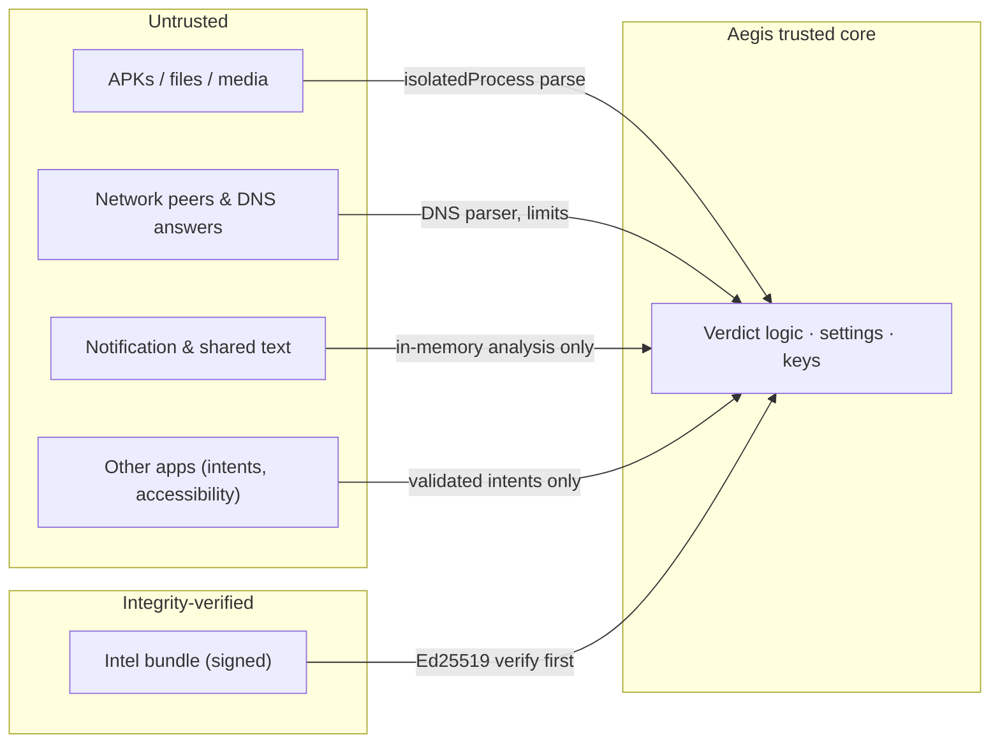

# Aegis Threat Model

*Last updated: 2026-11-01 · Status: Draft. Review at every milestone and whenever a permission or data flow changes.*

This document has two parts:

- **Part A** covers threats **to the user** that Aegis defends against, and how far each defense reaches.
- **Part B** covers threats **to Aegis itself**: attackers trying to bypass, disable, or abuse the security app.

Coverage levels: **Strong** (reliable within platform limits) · **Partial** (helps, but has known bypasses) · **Advisory** (informs the user without enforcing anything) · **None** (out of scope, stated so the UI doesn't imply otherwise).

---

## Part A: Threats to the user

### A1. Adversaries

| Adversary | Capability | Typical goal |
|---|---|---|
| Commodity malware operator | Distributes trojanized APKs through sideloading, third-party stores, and occasionally Play | Banking fraud, SMS fraud, ad fraud, credential theft |
| Stalkerware operator (often an intimate partner) | **Physical access** to the device, knows the PIN, installs a monitoring app | Location, messages, call logs, covert surveillance |
| Scammer using generative AI | LLM-written personalized messages, cloned voices, deepfake media, fake AI apps | Payment fraud, account takeover |
| Prompt-injection attacker | Plants instructions in web pages, messages, notifications, or QR codes that AI agents will read | Hijack an assistant into leaking data or taking actions |
| Data-harvesting app or SDK | Holds granted permissions and sends data to AI or analytics services | Profiling, training data, resale |
| AI crawler or agent operator | Automated fetching from published network ranges | Content collection for training or answers |
| Network attacker | Rogue or open Wi-Fi, malicious captive portal, user-installed CA certificate | Interception, phishing |

### A2. Classic threats

| Threat | Aegis controls | Coverage | Residual gaps |
|---|---|---|---|
| Malicious app installed (trojan, spyware, dropper) | Install and update scan, IOC, heuristics, DEX features, ML ([spec](features/malware-detection.md)) | Strong for known families; Partial for novel ones | Detection happens **after** install, because third-party apps cannot intercept an install. Droppers fetching payloads at runtime are caught only when the payload becomes an installed APK or a scannable file. |
| Stalkerware | IOC set, privileged-component audit, safety flow | Strong for indexed apps; Partial otherwise | A determined abuser with physical access can uninstall Aegis. Removing stalkerware may alert the abuser, so the safety flow warns first. |
| PUA, adware, fleeceware | PUA rules, permission audit | Partial | Subscription fraud happens inside Play billing, which Aegis cannot see. |
| Malicious APK file in Downloads | File scan (All files access) or a single-file scan | Strong when the permission is granted; Advisory without it | On Android 11+, the Download folder cannot be granted through a SAF tree, so automatic scanning needs All files access. |
| Phishing or malware domains | Shield DNS filter ([spec](features/network-protection.md)) | Partial | Bypassed by apps that use DoH or DoT directly, hardcoded IPs, or Private DNS in strict mode (detected and explained). It cannot see URL paths on HTTPS. |
| Malicious link in a message or QR code | Link checker, QR checker, scam detector | Partial | Only covers links that pass through Aegis (shared, scanned, or seen in a notification). |
| Unsafe network | Wi-Fi security type, captive portal, user-CA detection | Advisory | No ARP or DNS spoofing detection without root. |
| Device misconfiguration | Posture audit ([spec](features/device-security-audit.md)) | Advisory | Aegis can only recommend changes; it cannot change settings. |

### A3. AI-specific threats

| Threat | Aegis controls | Coverage | Residual gaps |
|---|---|---|---|
| **Fake or trojanized AI-assistant apps** | Official-app registry (package and certificate), lookalike label and icon detection | Strong for registered brands | New brands need a registry update. |
| **AI-written phishing and smishing** | Scam detector on notifications and shared text, with URL reputation. It detects *scam intent*, not AI authorship ([rationale](features/ai-threat-defense.md#ai-4-scam-and-smishing-detection)). | Partial | Requires notification access (opt-in). Android 15+ hides OTP-bearing notification content from untrusted listeners, which is acceptable because Aegis does not need OTPs. End-to-end-encrypted apps that hide notification previews cannot be analyzed. |
| **Prompt injection against on-device assistants and agents** | Hidden-text and injection scanner for shared content, notifications, and QR payloads | Partial | Aegis cannot inspect what another app's agent reads in real time without an AccessibilityService, which it deliberately avoids ([ADR-0004](adr/0004-no-accessibility-service.md)). |
| **Over-privileged AI agents** (screen readers, notification readers) | Agent guard alerts and the AI access audit | Strong for detecting the grant; Advisory for the decision | Aegis can't stop a granted capability. The user revokes it. |
| **AI data egress from apps** | AI egress monitor and per-app egress control (DNS) | Partial | Bypassed when apps proxy AI calls through their own backend, use DoH, or hardcode IPs. |
| **Deepfake images and video** | C2PA and IPTC provenance check on shared media | Advisory | Missing credentials prove nothing, and metadata is easily stripped. The UI never claims "real" or "fake". |
| **Voice-clone scam calls** | Safe-word helper and verification checklist | Advisory | Third-party apps cannot access call audio, so real-time detection is impossible. |
| **AI crawlers and agents** | AI Crawler Shield ([spec](features/ai-crawler-shield.md)) | Strong for outbound traffic to listed ranges; inbound gated on spike S3 | Unlisted operators, crawlers that use residential proxies, and user-agent-only identification are not covered. |
| **LLM-mutated or obfuscated malware** | Layered detection with features that are costly to remove, and adversarial evaluation | Partial | This is an arms race. Signature updates and model retraining are ongoing work. |

---

## Part B: Threats to Aegis (STRIDE)

### B1. Assets

Integrity of the intel bundle · correctness of verdicts · the Shield's availability (users' connectivity) ·
the local data: installed-app inventory, findings, aggregated DNS counters, safe word · user trust.

### B2. Trust boundaries

### B3. Threats and mitigations

| STRIDE | Threat | Mitigation | Verified by |
|---|---|---|---|
| **S**poofing | A forged intel bundle disables detection or blocks legitimate sites | Ed25519 signature with pinned keys, verified before parsing. Key IDs allow rotation. | Unit tests with tampered bundles, plus a CI test that uses an unsigned bundle |
| Spoofing | A repackaged Aegis APK is distributed with malware | Play App Signing, and a runtime self-check of the signing certificate with a warning screen | Instrumented test with a re-signed build |
| **T**ampering | A rollback to an old bundle that does not detect a new family | Monotonic version check. The previous bundle is kept only for local rollback. | Unit tests |
| Tampering | A malicious app sends crafted intents to Aegis's exported share activity | MIME and size limits, copy into the sandbox, parse in `:parser`, no implicit actions | Fuzzed intents, plus a MASTG platform test |
| Tampering | A malicious app starts the exported launcher activity, or broadcasts to the library-merged `ProfileInstallReceiver` | The launcher activity reads no intent data or extras. `ProfileInstallReceiver` requires `android.permission.DUMP`, which ordinary apps can't hold. Only the system, privileged system apps, and the adb shell have it. Debug builds also export Compose's `PreviewActivity`, with no protection, so debug builds stay inside the team ([PERMISSIONS_AND_POLICY § Exported components](PERMISSIONS_AND_POLICY.md#exported-components-and-merged-manifest-entries)). | Merged-manifest review on every dependency change |
| **R**epudiation | A user disputes that Aegis took an action | A local, append-only action log (alerts shown, user decisions). It is never uploaded. | Review |
| **I**nformation disclosure | The app inventory or DNS counters leak through backup, logs, or a world-readable file | `allowBackup=false`, exclusion rules, SQLCipher, a PII-free logging facade, no external-storage writes | MASTG storage tests, plus the `checkSourceRules` CI gate, which bans `Log.*`, `println`, and `System.out`/`err` outside the logging facade |
| Information disclosure | A screen-reading app captures Aegis screens, such as the safe word | `FLAG_SECURE` and `setAccessibilityDataSensitive` on sensitive screens | Instrumented test |
| **D**enial of service | A zip bomb or malformed DEX hangs or crashes the scanner | Isolated process, entry and size and ratio limits, timeouts, crash-tolerant orchestrator that records an *unscannable* finding | Jazzer fuzzing plus a corpus of malformed fixtures |
| Denial of service | A Shield bug breaks device connectivity | Fail open with a persistent alert, a watchdog, and a kill switch in the notification | Chaos tests in S1 and the Phase 3 test plan |
| Denial of service | Malware kills Aegis or stops it from running | Limited by the platform. Aegis detects accessibility-based automation and alerts. Always-on VPN restarts the Shield. | Manual test |
| **E**levation of privilege | A parser exploit gains Aegis's permissions | `isolatedProcess` has no permissions. Features are returned as plain data structs. | Architecture review |
| Elevation of privilege | A prompt injection in analyzed content manipulates the verdict | No LLM in the verdict path ([ADR-0005](adr/0005-llms-excluded-from-verdict-path.md)). Any optional explanation feature treats content strictly as data. | Design review, plus injection fixtures in tests |
| Adversarial ML | Evasion samples tuned against the on-device model | Ensemble precedence (ML alone yields at most *Suspicious*), no raw scores shown, signed model updates, adversarial evaluation | [TESTING § Adversarial evaluation](TESTING.md#adversarial-evaluation) |
| Supply chain | A compromised dependency or CI action | Gradle dependency verification, actions pinned by SHA, license allowlist, minimal permissions in the CI token, signing key kept out of CI | CI configuration review |

### B4. Review triggers

Update this document when any of the following changes: a new permission, a new exported
component, a new outbound network destination, a new data source, a new parser, or a change to
verdict precedence.
