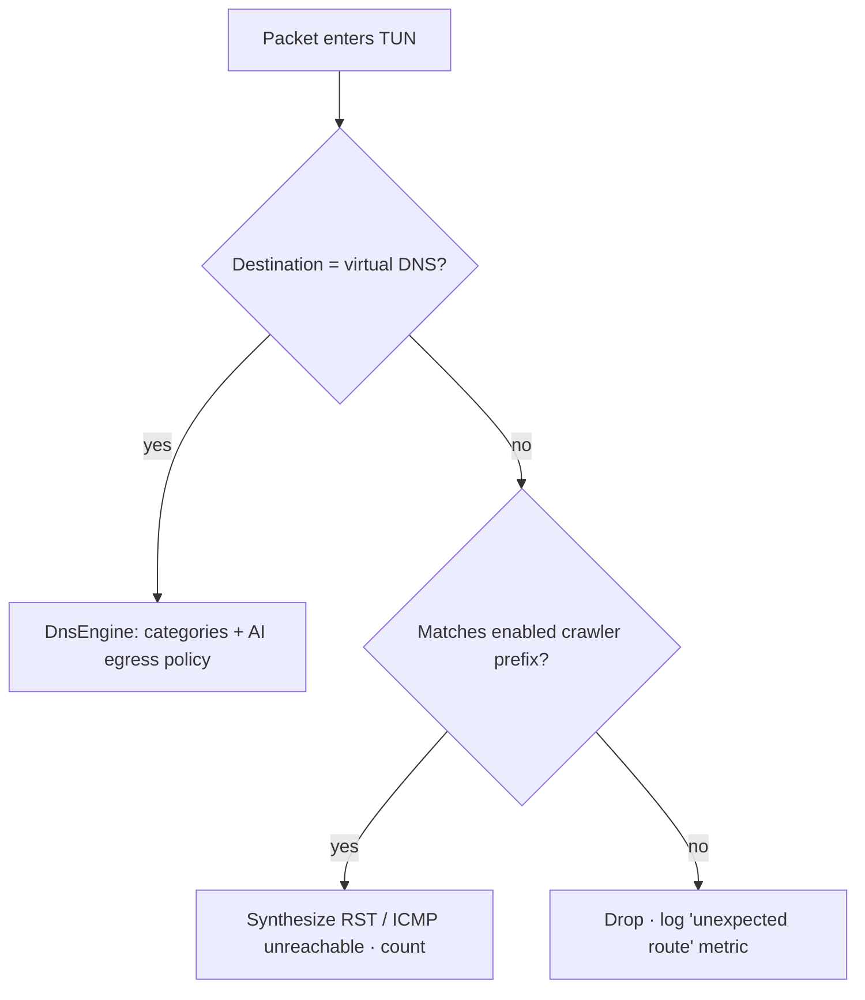

# Feature Spec: AI Crawler Shield

*Last updated: 2026-10-31 · Status: Draft. Scope needs owner confirmation (see [PLAN § Open decisions](../PLAN.md#6-open-decisions) #1).*
Requirements: FR-ACS-01 … FR-ACS-09 · Depends on: [Network protection (Aegis Shield)](network-protection.md) · Phase 4

---

## 1. Problem framing

The request is to *block AI crawlers from reaching the device when the user turns this on*.
To build that honestly, the spec has to start with how AI crawlers interact with a phone.

**What an AI crawler is.** An AI crawler is an automated HTTP client run by an AI company. Each one
fits one of three roles:

| Role | Examples (from operator docs) | Respects robots.txt? |
|---|---|---|
| Training crawler | GPTBot (OpenAI), ClaudeBot (Anthropic), CCBot (Common Crawl) | Operators say yes |
| AI search indexer | OAI-SearchBot, Claude-SearchBot, PerplexityBot | Operators say yes |
| User-triggered fetcher or agent | ChatGPT-User, Claude-User, Perplexity-User | Often **no**. OpenAI and Perplexity say robots.txt may not apply to fetches a user initiates. |

**Why a phone is rarely reached directly.** Crawlers fetch from *servers*. A phone normally
sits behind carrier-grade NAT on cellular, or behind a home router's NAT on Wi-Fi, so
unsolicited inbound connections usually cannot reach it at all. The realistic ways AI crawling
touches a phone are these:

| # | Exposure path | Realistic? | What Aegis can do (non-root) |
|---|---|---|---|
| E1 | The device **hosts a service**: a local web server (for example, in Termux), a file-sharing app with an HTTP server, or wireless ADB. It is reachable through a global IPv6 address or a shared LAN. | Uncommon, but real | Warn through the **exposure check**. Blocking inbound traffic requires root unless spike S3 shows that reply packets can be captured (§6). |
| E2 | Apps or WebViews on the device **connect to** AI crawler or fetcher infrastructure, for example through relays, agent sessions, or SDKs that phone home through those ranges | Uncommon | **Block** with routes to the published prefixes (Standard and Strict levels). |
| E3 | Apps send device content (screen text, files, messages) to **AI services**. In practice this is how "AI crawling" happens on a phone. | **Common** | **Control** with per-app DNS egress policy for AI API endpoints (AI service egress control). |
| E4 | On-device AI agents read the screen or notifications | Common | Handled by [AI threat defense](ai-threat-defense.md#ai-3-agent-guard) (agent guard and the AI access audit), linked from this screen. |

**Proposed definition of the feature.** When the user turns on AI Crawler Shield, Aegis:

1. Drops traffic between the device and the **published network ranges of AI crawlers and fetchers** (E2, and E1 if S3 passes).
2. Optionally applies **per-app AI service egress control** (E3).
3. Shows an **exposure check** that explains how reachable the device actually is (E1).

It does **not** inspect HTTP user agents or decrypt TLS ([ADR-0002](../adr/0002-no-tls-interception.md)).
It does not claim to stop crawlers that use unpublished or residential IP addresses.

## 2. User experience

```
AI Crawler Shield                                   [  OFF  ]
Blocks known AI crawler and AI agent networks on this device.

When on:
  Protection level     (•) Standard   ( ) Strict
  AI service control   [ off ]  Choose which apps may send data to AI services
  ───────────────────────────────────────────────
  Status        412 network ranges active · list v2026.10.30
  Blocked       37 connections this week  › details
  Exposure      Low: no public address on this network  › why
  Sources       OpenAI · Perplexity · Anthropic · Common Crawl  › provenance
```

- **Turning it on** when the Shield VPN is off shows the VPN prominent disclosure, then the system `VpnService.prepare` consent dialog. If the user cancels, the toggle reverts and the screen explains why.
- **Another VPN is active:** the toggle is disabled and the screen says: "Android allows one VPN at a time. Turn off *<other VPN>* to use AI Crawler Shield, or use that VPN's own blocklists."
- **Strict level** warns: "Also blocks search crawlers from Google and Apple whose data can feed AI features. Rarely affects normal phone use."
- **Details** lists blocked connections per operator and per app (aggregated by day), with "Allow this app" and "Allow this range" overrides.
- **Copy constraints (FR-ACS-08):** the UI must never say "invisible to AI", "AI can't access your data", or "blocks inbound crawlers" unless spike S3 has passed. Approved wording: "Blocks connections to and from known AI crawler networks", "Controls which apps can reach AI services".

## 3. Requirements and acceptance criteria

| ID | Acceptance criteria |
|---|---|
| FR-ACS-01 | It is off on a fresh install. Turning it on with the Shield off triggers the disclosure and then system consent. The state persists across reboot. With Always-on VPN enabled, it resumes on boot. |
| FR-ACS-02 | At *Standard* level, a TCP connection from a test app to an address inside each Standard-category prefix fails within 1 s (RST or ICMP unreachable), and a control address outside the prefixes still connects. |
| FR-ACS-03 | *Strict* adds the Strict-category prefixes and shows the warning above. Switching back to Standard removes them within 5 s. |
| FR-ACS-04 | With egress control on, a non-allowlisted test app resolving a listed AI API domain gets NXDOMAIN, and an *Ask* prompt appears (at most one per app per hour). Verified official AI apps (by package and certificate) are pre-allowed. |
| FR-ACS-05 | The exposure check reports: a global IPv6 address on the active network, open Wi-Fi, and wireless debugging (where readable). Each item explains what it means and what the user can do. |
| FR-ACS-06 | Counters update within 60 s, and the list version and number of active prefixes are shown. |
| FR-ACS-07 | Every prefix shows its operator, source URL, and fetch date, and can be overridden individually. |
| FR-ACS-08 | A copy review checklist runs on every UI change (part of the definition of done). |
| FR-ACS-09 | When the compiled prefixes exceed the route cap, Strict prefixes are dropped first, and the status shows "Partial: N ranges not applied". |

## 4. Data: crawler range sources

All of these are **published by the operators themselves** for verification purposes. The
pipeline fetches them in CI and never on the device. Full terms are tracked in [DATA_SOURCES](../DATA_SOURCES.md#ai-crawler-ranges).

| Operator | Agent(s) | Source | Category |
|---|---|---|---|
| OpenAI | GPTBot | `https://openai.com/gptbot.json` | Standard |
| OpenAI | OAI-SearchBot | `https://openai.com/searchbot.json` | Standard |
| OpenAI | ChatGPT-User | `https://openai.com/chatgpt-user.json` | Standard |
| OpenAI | OAI-AdsBot (ad landing-page safety checks, not training) | `https://openai.com/adsbot.json` | Strict |
| Perplexity | PerplexityBot | `https://www.perplexity.ai/perplexitybot.json` | Standard |
| Perplexity | Perplexity-User | `https://www.perplexity.ai/perplexity-user.json` | Standard |
| Anthropic | ClaudeBot, Claude-User, Claude-SearchBot | `https://claude.com/crawling/bots.json` | Standard |
| Common Crawl | CCBot (a widely used AI training corpus) | `https://index.commoncrawl.org/ccbot.json` | Standard |
| Apple | Applebot (search; its data can train Apple models unless a site opts out with `Applebot-Extended`) | `https://search.developer.apple.com/applebot.json` | Strict |
| Google | Googlebot and other common crawlers (search; Gemini grounding draws on the index) | `https://developers.google.com/static/crawling/ipranges/common-crawlers.json` | Strict |
| Google | User-triggered agents | `https://developers.google.com/static/crawling/ipranges/user-triggered-agents.json` | **Candidate.** Classify after confirming what it covers. |

**Not blockable at the network level, by design:** `Google-Extended` and `Applebot-Extended` are
robots.txt *control tokens*. They do not crawl from distinct addresses. Apple states that
Applebot-Extended "does not crawl webpages". The UI says this, so users understand why those
tokens are absent from the list.

**Names and metadata:** the [ai.robots.txt](https://github.com/ai-robots-txt/ai.robots.txt)
project (MIT) is used as a cross-reference for operator and agent names in the registry. It is
not used for matching, because Aegis does not inspect user agents.

**Operators without published ranges** (for example, crawlers identified only by user agent)
are not covered. The provenance screen lists the operators that *are* covered, so the gap is visible.

## 5. Design

### 5.1 Enforcement through split routing

This reuses the Shield VPN ([ADR-0003](../adr/0003-local-vpn-split-routing.md)). Only these destinations are routed into the TUN:

- the virtual DNS resolver address (always, for the Shield's DNS filter), and
- each **enabled crawler prefix** (IPv4 and IPv6).

All other traffic bypasses the VPN entirely, so the battery and latency cost stays close to zero.

Packets that arrive in the TUN for a crawler prefix are **dropped with a fast failure**:

- TCP SYN gets a synthesized RST, so apps fail fast instead of waiting for a timeout.
- UDP and other protocols get ICMP/ICMPv6 destination-unreachable (administratively prohibited).
- Each drop increments `BlockCounter(day, uid, category=ai_crawler, operator)`. The UID comes from `getConnectionOwnerUid`, with sampled lookups and caching to limit cost.



Overrides never reach this loop. An overridden prefix is no longer routed, and an overridden
app no longer uses the tunnel (see the note below).

*Note on overrides.* A route is device-wide, so a **per-prefix** override removes that prefix
from the route set at the next rebuild (within 5 s). A **per-app** override cannot be expressed
with routes alone. Aegis instead adds the app to the VPN's disallowed-applications set
(`addDisallowedApplication`), so it bypasses the tunnel completely. This also removes that app
from DNS filtering, and the UI says so.

### 5.2 Route set compilation (CI, `tools/intel-pipeline`)

1. Fetch each source, record the HTTP date and ETag, and parse the JSON prefix lists (formats differ per operator, so each source has its own adapter).
2. Validate each prefix:
   - Reject IPv4 prefixes shorter than `/16` and IPv6 prefixes shorter than `/32`, to prevent collateral blocking of shared cloud ranges.
   - Reject any prefix that overlaps the **canary allowlist**: ranges for major CDNs, DNS resolvers, and popular services, plus the bundle host itself.
   - Fail the build if churn exceeds 30% against the previous release; a maintainer must approve.
3. Aggregate adjacent and overlapping prefixes within the same category.
4. Emit `crawler_ranges.pb` with: prefix, family, category, operator, source ID, fetchedAt.
5. Sign the bundle as part of the normal intel release ([ADR-0006](../adr/0006-signed-threat-intel-updates.md)).

### 5.3 Route cap

The safe number of routes per device is determined by spike S2. Until then, use a provisional
cap of **2,000 prefixes**. If the compiled list exceeds the cap, prefixes are applied in this order:
Standard training crawlers → Standard user-triggered fetchers → Standard search indexers → Strict.
Anything left over is reported as *Partial*.

### 5.4 AI service egress control (DNS)

- A domain category `ai_service` (AI inference, API, and telemetry endpoints) ships in the bundle, compiled from a curated config in `tools/intel-pipeline/sources/ai-services.yaml`. Each entry needs evidence, meaning the vendor's documentation of the API host. Illustrative examples: `api.openai.com`, `api.anthropic.com`, `generativelanguage.googleapis.com`.
- The policy is `AiEgressPolicy(packageName, certSha256, mode)`, where mode is allow, block, or ask. The default for an unknown app is **ask**. Verified official AI apps from the [impersonation registry](ai-threat-defense.md#ai-1-ai-app-impersonation) are allowed by default.
- In *ask* mode, the first lookup returns NXDOMAIN and posts a notification: "*App* tried to reach *OpenAI API*. Allow / Keep blocked". Prompts are rate-limited to one per app per hour.
- **Limitations shown to the user:** apps that proxy AI calls through their own servers, use DoH, or hardcode IP addresses are not controlled.

### 5.5 Exposure check

| Signal | API | Interpretation |
|---|---|---|
| Global IPv6 on the active network | `ConnectivityManager.getLinkProperties(activeNetwork).linkAddresses` (scope global, not ULA or link-local) | "Your device has a public IPv6 address on this network. Most carriers and routers still block unsolicited inbound traffic, but services you run on the phone may be reachable." |
| Open or weak Wi-Fi | `WifiInfo.getCurrentSecurityType()` (API 31+) | Others on the network can attempt connections. |
| Wireless debugging | `Settings.Global` read, where permitted. Verify readability during implementation. | "Turn off Wireless debugging when you're not using it." |
| Shield active and Strict level | Internal state | Context for the score |

The result is Low, Medium, or Elevated, with explanations. Aegis cannot enumerate listening
ports of other apps (`/proc/net` has been restricted for apps since Android 10), so the check
never claims "no services running".

## 6. Inbound traffic: spike S3

**The open question:** when a crawler prefix is routed into the TUN, does a reply from an
on-device listening socket (for example, SYN-ACK from a local web server) to a crawler address
follow that route into the TUN, where Aegis would drop it? If it does, inbound connections from
listed ranges would fail too.

Android's routing marks accepted sockets based on the network the incoming packet arrived on,
so replies may well bypass the VPN. **The working assumption is that inbound blocking is not
provided.**

**Test procedure:**

1. Run a local HTTP server on the test device with a global IPv6 address, or on a LAN with a test host whose address falls inside a temporarily added test prefix.
2. With the Shield on and the test prefix routed, connect from the test host.
3. Record whether the handshake completes, on Pixel, Samsung, and Xiaomi with Android 13, 15, and 17.

**Outcomes:**

- Capture is consistent on every device in the matrix → document it, update FR-ACS-08 copy to allow "Blocks connections to and from…", and add a regression test.
- Otherwise → the UI says "Blocks connections from this device to known AI crawler networks", and inbound protection stays out of scope (root only).

## 7. Edge cases

| Case | Behavior |
|---|---|
| Lockdown ("Block connections without VPN") is on | Validate in S1. If lockdown interferes with split routing, warn before enabling it. |
| Private DNS in strict mode | This does not affect prefix blocking (routes are IP-based). It does affect egress control (DNS-based), which shows a warning. |
| An IPv6-only network or a 464XLAT network | Both address families are routed. Test on carrier networks in the device matrix. |
| A bundle update changes the prefixes while connected | Rebuilding the VPN interface briefly re-establishes the tunnel. Debounce and apply at most once every 5 min unless the user triggered the update. |
| A prefix overlaps a service the user needs | Per-prefix override from the details screen. A Report action generates a local report the user can send. |

## 8. Testing

- **Unit:** prefix parsing per source adapter, aggregation, breadth and canary validation, route-cap ordering, RST and ICMP synthesis (checksums), and DNS policy decisions.
- **Instrumented:** a fixture app connects to a test address inside a test-only prefix that is injected through a debug bundle, and asserts fast failure. Also cover override behavior and the reboot plus Always-on case.
- **Pipeline:** golden-file tests for each source format, and a test that a churn-gate failure blocks the release.
- **Manual:** S3 inbound procedure, plus lockdown and Private DNS interactions on the device matrix.
- **Copy review:** checklist against §2 copy constraints.

## 9. Future options (not in 1.0)

- A root-mode inbound firewall for rooted devices.
- Verifying signed agent requests (HTTP message signatures for bots). This is only relevant if Aegis ever terminates HTTP, which it doesn't.
- Community-sourced ranges for operators that don't publish them. This would need a strong evidence bar.
