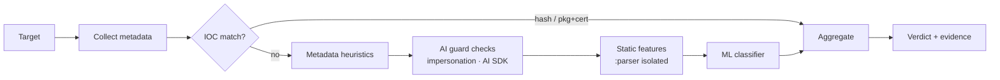

# Feature: Malware detection and scanning

This spec is a draft, and nothing in it is built yet.

- **Requirements:** FR-SCAN-01 … FR-SCAN-10, FR-DET-01 … FR-DET-07
  (`docs/requirements.md`).
- **Roadmap:** Phases 1 and 6 (`docs/roadmap.md`).

## Summary

Aegis scans installed apps and APK files to find malware, stalkerware, and
potentially unwanted apps (PUA). Detection combines several independent
signals (IOC, heuristics, static features, and ML), and an explicit
precedence policy turns those signals into one verdict. The aim is to keep
false positives low while still catching new variants.

## Triggers

| Trigger | Mechanism | Scope |
| :- | :- | :- |
| App installed or updated | `getChangedPackages(seq)` (on app start, every 15 min, and from the runtime receiver while `:shield` runs) | Changed packages |
| On-demand | User taps *Scan now* | All user-installed apps and updated system apps; optionally files |
| Scheduled | Daily WorkManager job (battery not low, device idle preferred) | Incremental: only packages whose fingerprint changed, or that haven't been re-checked since an intel version bump |
| Intel bundle updated | After the swap | Re-match IOCs for **all** apps (cheap metadata match). Static and ML stages re-run only if their rules or model changed. |
| New file in shared storage | `FileObserver` on `Download/` while Aegis is alive, plus an inventory diff on each scan. Requires All files access. | New APK/APKS/XAPK/ZIP files |
| Single file | System picker (`ACTION_OPEN_DOCUMENT`) or share-to-Aegis | That file |

Android gives third-party apps no hook to scan a package **before** it is
installed. Aegis can catch an APK *file* before the user opens it (with All
files access), and otherwise it scans immediately after install. The UI
says this plainly.

## Detection pipeline

Stages run from cheapest to most expensive, and a decisive result stops the
pipeline early. Each stage emits
`Signal(detectorId, ruleId, strength, evidence)`.

### Metadata collection (main process)

- **Package info:** `PackageInfo` with `GET_SIGNING_CERTIFICATES` (API
  28+), `GET_PERMISSIONS`, and the services, receivers, and activities.
- **Signers:** signing certificate SHA-256 values (all signers, plus the
  rotation history from `signingInfo`).
- **Installer:** from `getInstallSourceInfo()` on API 30+, or
  `getInstallerPackageName()` on 29.
- **Granted runtime permissions:** from
  `requestedPermissionsFlags & REQUESTED_PERMISSION_GRANTED`.
- **Privileged components:**
  - services declaring `BIND_ACCESSIBILITY_SERVICE`,
    `BIND_NOTIFICATION_LISTENER_SERVICE`, or `BIND_DEVICE_ADMIN`
  - which of these are **enabled** (from
    `AccessibilityManager.getEnabledAccessibilityServiceList`,
    `NotificationManagerCompat.getEnabledListenerPackages`, and
    `DevicePolicyManager.getActiveAdmins`)
- **Flags:** `FLAG_DEBUGGABLE`, targetSdk, a launcher activity present or
  disabled, and whether it is a system app.
- **Content fingerprint:** from
  `(sourceDir, splitSourceDirs, size, lastUpdateTime)`. It is the cache key
  that decides whether hashing is needed.

### IOC matching (`engine:signatures`)

| Indicator | Match | Strength |
| :- | :- | :- |
| APK SHA-256 (base and each split) | Exact | **Decisive** |
| Package name + signing certificate SHA-256 | Exact pair | **Decisive** |
| Signing certificate SHA-256 alone | Exact (for certificates used only by malware families) | Strong |
| Package name alone | Exact | Weak. It is only a hint, because malware reuses legitimate names and vice versa. |

The IOC sets are sorted arrays of hashes in the bundle, memory-mapped and
searched by binary search. Hashing streams the file in 1 MiB chunks; a scan
can be cancelled between chunks.

### Metadata heuristics (`engine:heuristics`)

The rules are declarative and live in the intel bundle (`rules.pb`). Each
one has an ID, a version, a severity, and an explanation template.
Illustrative v1 rules:

| Rule | Condition | Typical threat |
| :- | :- | :- |
| H-BANKER-01 | Accessibility service + `SYSTEM_ALERT_WINDOW` + (notification listener or SMS permissions) + not installed from a known store | Banking trojan or overlay attack |
| H-SPY-01 | Device admin + background location granted + microphone granted + no launcher entry | Spyware or stalkerware |
| H-DROP-01 | `REQUEST_INSTALL_PACKAGES` + sideloaded + low targetSdk + an embedded APK or DEX in assets (static stage) | Dropper |
| H-SMS-01 | `SEND_SMS` granted + not the default SMS app + sideloaded | Premium SMS fraud |
| H-DEBUG-01 | A debuggable app installed from outside Play | Repackaged or test build |
| H-STALE-01 | targetSdk well below the current Play floor + dangerous permissions granted | Old or abandoned app, often repackaged |

Heuristics on their own produce *Suspicious*, *PUA*, or (when a rule is
marked high-confidence) *Malicious*. The rule thresholds are tuned against
the benign corpus (`docs/04-quality.md`, "Detection quality").

### Static features (`engine:apk`, in `:parser`)

- **ZIP layer:** entry count, compression ratios, nested APK/DEX/JAR files
  in `assets/` or `res/raw`, and unusual entry names. Limits: at most 20k
  entries, at most 2 GB uncompressed, ratio ≤ 100:1, and a 30 s wall clock
  per APK.
- **Binary manifest:** full parse, including components that the
  `PackageManager` view omits, such as `<queries>`, aliases, and exported
  flags.
- **DEX:** a string table plus method and type references with no full
  decompilation. Flags cover dynamic loading (`DexClassLoader`,
  `InMemoryDexClassLoader`), reflection density, `Runtime.exec`,
  accessibility gesture APIs (`dispatchGesture`, `performGlobalAction`),
  overlay window types, SMS APIs, crypto-mining strings, and known packer
  stubs.
- **Native:** ELF headers and the imported or exported symbols of `.so`
  files, plus known native packer names.
- **Output:** a sparse feature vector together with human-readable evidence
  strings. These are bounded in length and never include raw file content.

### ML classifier (`engine:ml`)

- **Model:** a gradient-boosted or small MLP classifier exported to
  **LiteRT**, at most 5 MB and at most 50 ms per app (spike S5).
- **Features:** permissions, components, API references, manifest and ZIP
  statistics, and installer. Prefer features that are **costly for an
  attacker to remove** without losing malicious capability.
- **Training:** offline, outside the app. Dataset terms are respected (for
  example, research datasets that require an access agreement) and recorded
  in `docs/data-sources.md` ("ML training data").
- **Calibration:** pick the threshold that reaches a false-positive rate of
  0.1% or lower on the benign corpus, and report the TPR at that threshold.
- **Delivery:** the model ships in the signed bundle with
  `minEngineVersion`.

### Verdict aggregation

| Signals present | Verdict |
| :- | :- |
| Any **decisive** IOC | *Malicious* (or *Stalkerware* if the IOC set is stalkerware) |
| A high-confidence heuristic, or (strong IOC + any heuristic) | *Malicious* |
| A stalkerware heuristic, or a weak stalkerware IOC | *Stalkerware (possible)*, which goes through the safety flow |
| ML ≥ threshold + any heuristic | *Malicious* |
| ML ≥ threshold alone | *Suspicious*, **never** *Malicious* |
| PUA rule | *PUA*. Users can hide this category. |
| Static parse failed because a limit was exceeded | *Unscannable*. This is informational, and becomes *Suspicious* if the app is also sideloaded. |
| None | Clean |

## Remediation

| Verdict | Primary action | Secondary |
| :- | :- | :- |
| Malicious | **Uninstall** with `PackageInstaller.uninstall` (needs `REQUEST_DELETE_PACKAGES`; the system shows a confirmation) | App info, Trust (with an explicit warning) |
| Device admin is active | Guide the user: deactivate the admin first (deep link to device admin settings), then uninstall | |
| Stalkerware | **Safety flow** (`device-security-audit.md`, "Stalkerware safety flow"), never one-tap removal | |
| Suspicious or PUA | Review the evidence, then uninstall or trust | Revoke permissions (deep link) |
| Malicious file | Delete it if it lives somewhere Aegis can write, or **quarantine** it: encrypt with Tink AEAD into app-private storage and delete the original | Restore from quarantine |

**Trust rules** are pinned to `(packageName, certSha256)`. An update signed
by a different certificate re-opens the finding.

## Performance

- **First full scan:** hash every APK, with throughput measured in S4.
  After that, the cache keyed by content fingerprint avoids re-hashing.
- **Parallelism:** at most 2 concurrent `:parser` analyses, reduced to 1
  when the device is in thermal throttling or battery saver.
- **Budgets:** NFR-PERF-01 (150 apps in 2 min or less once warm) and
  NFR-PERF-04 (peak memory 150 MB or less).

## Acceptance criteria (selected)

- The AMTSO Android test artifacts and every malicious-profile fixture in
  `testing/fixtures` produce the expected verdicts.
- 0 *Malicious* verdicts on the benign corpus, and *Suspicious* on 0.5% or
  less of it, per release.
- A fixture zip bomb produces *Unscannable* within 30 s with no crash in
  the main process.
- Installing a fixture APK produces a verdict notification within 10 s of
  change detection.
- A trusted app that updates with a different certificate re-opens its
  finding.
