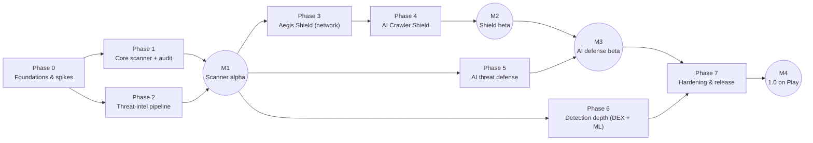

# Roadmap

How to use this file:

- Work top to bottom. A task is **unblocked** when everything in its
  `Depends` line is ticked. Phases 1 and 2 run in parallel. Phases 5 and 6
  can too, if a second contributor joins.
- The `Depends` lines also carry the phase-level order. A spike gates
  every task in the phases its `Blocks` line names: Phase 1 waits on S4,
  Phase 3 on S1, Phase 4 on S1 and S2 (and its UI copy, P4.7, on S3),
  Phase 5 on S5, S6 and S7, and Phase 6 on S4 and S5. The arrows in the
  delivery overview hold too: Phases 1 and 2 build on the Phase 0 tasks
  they name, Phases 3, 5 and 6 start after M1 (P2.7), Phase 4 follows
  Phase 3 (P4.1 depends on P3.1), M3 (P5.10) follows M2 (P4.8), and Phase
  7 follows M3 and Phase 6. Each task lists these in its `Depends` line,
  or depends on a task that does.
- `/next-task [task-id]` picks the first unblocked task, or the one named,
  and carries it through the definition of done. Requirement work inside a
  task follows `/implement-requirement <ID>` for each ID on its
  `Requirements` line. Spikes run with `/run-spike S<n>`, which writes
  `docs/spikes/S<n>-<slug>.md`. Finish every task with `/pre-pr-check`.
- Tick a box only after its acceptance criteria are met **and** its
  verification commands were run and passed (see "Definition of done for a
  roadmap task" in `AGENTS.md`).
- If a check needs a physical device, OEM hardware, the lab, Play Console,
  or a CI run on GitHub that you can't do, leave the box unchecked. Add an
  indented note saying exactly what remains:
  `  - ⏳ needs Samsung and Xiaomi devices: the 48 h S7 delivery run`.
- Add indented `Note:` lines under a task for what the work settled:
  pinned versions, measured numbers, conventions chosen, follow-ups. A
  follow-up for a later task goes under that task as
  `Note (from P0.8): …`.
- Until P0.9 (the ADR review after the spikes), Phase 0 tasks and spikes go
  ahead on the `Proposed` ADRs, because the spikes exist to test them. After
  P0.9, a task that relies on a still-`Proposed` ADR starts by asking the
  owner to accept, change or reject it (`docs/decisions.md`). All seven ADRs
  are `Proposed` today.
- A task that waits on an open decision (`docs/00-overview.md`, "Open
  decisions") names it in its `Depends` line. The owner decides it before
  the task starts.
- `Requirements:` names the FR-* and NFR-* IDs a task implements
  (`docs/requirements.md`). `Accept:` lines come from the feature specs'
  acceptance criteria (`docs/features/*.md`) and the requirement wording.
- Every task also meets the definition of done in `AGENTS.md`
  ("Definition of done for a roadmap task"): the requirement IDs are
  implemented and linked in the PR; unit tests, plus instrumented tests
  where platform APIs are involved, with CI green; the spec, the
  permissions table, and the privacy data inventory updated; every new
  permission behind a disclosure, with a fallback; performance budgets
  checked on the reference mid-range device; and UI copy reviewed against
  the honest-claims rule (`AGENTS.md` rule 10).
- Exit lines are checked by the owner.

Status: **Phase 0 in progress** (2026-11-07). The build and tooling tasks
are done and verified locally, except CI, which hasn't passed on GitHub
yet (P0.3). P0.1, P0.2 and P0.4–P0.8 were ticked on that local
verification (2026-11-01) before CI passed on GitHub, so for them the
definition of done's "CI is green" is met only when P0.3 is. Spikes S1–S7 and
everything from Phase 1 on haven't started. A ticked box is done. The
phases, their order, and the estimates are a draft for owner review
(2026-11-01).

This roadmap takes Aegis from an empty repository to a 1.0 release on
Google Play. Work is sequenced so that the highest-risk platform questions
are answered first (the Phase 0 spikes), so that a usable scanner exists
early (M1), and so that every later feature builds on a tested core.
Related: `docs/requirements.md`, `docs/01-architecture.md`,
`docs/threat-model.md`.

Delivery overview:

Effort per phase, and the assumptions behind it: `docs/00-overview.md`
("Scope estimate").

---

## Phase 0 — Foundations and technical spikes

**Goal:** the project scaffold, CI, the core security plumbing, and
evidence for the riskiest platform questions (spikes S1–S7).
**Effort:** about 3 weeks. **Milestone:** M0 Foundations ready.

### Build and tooling

- [x] **P0.1 — Multi-module Gradle build and convention plugins**
  - Depends: —
  - Requirements: NFR-COMP-01; groundwork for NFR-SEC-05 and NFR-MAINT-01
  - Do:
    - A multi-module Gradle build (Kotlin DSL) with a version catalog
      (`gradle/libs.versions.toml`) and convention plugins in
      `build-logic/`, laid out as in `docs/01-architecture.md` → "Module
      layout" and "Convention plugins".
    - The foundation modules `app`, `core:common`, `core:data`,
      `core:model`, `core:security`, `core:ui` and `testing:common`. Later
      modules are added with `/new-module` when their phase starts.
    - Base package and applicationId `io.github.jabbottiii.aegis`; minSdk
      29, compileSdk and targetSdk 37 (ADR-0007).
  - Accept:
    - Every dependency and plugin version is in the catalog, with no
      inline versions. The SDK levels live there, and only the convention
      plugins read them.
    - `assembleDebug` and `assembleRelease` succeed. The release build
      uses R8 and resource shrinking, and is signed from the
      `AEGIS_SIGNING_*` environment variables.
  - Verify: `./gradlew assembleDebug assembleRelease`
  - Note: done and verified locally on 2026-11-01. AGP 9.5.0 with built-in
    Kotlin (Android modules don't apply `org.jetbrains.kotlin.android`),
    Gradle 9.8.2, and a JDK 21 daemon
    (`gradle/gradle-daemon-jvm.properties`), because detekt 1.23 can't
    start on JDK 25. Compiled code targets Java 17.
  - Note: the owner chose the package and minSdk 29 on 2026-11-01.
    ADR-0007 records both and is still `Proposed`.
  - Note: `aegis.jvm.engine` gives the six pure modules explicit API mode
    and the ≥ 80% Kover gate. `engine:scanner`, `engine:ml`,
    `intel:client` and a non-pure `ai:guard` would get neither: open
    decision #8, decided before the first of them is created (P1.2, which
    creates `engine:scanner`).

- [x] **P0.2 — Module-graph and source-rule checks**
  - Depends: P0.1
  - Requirements: — (the rules in `docs/01-architecture.md` → "Dependency
    rules")
  - Do: `checkModuleGraph` (with a `checkResolvedGraph` task in each
    module) and `checkSourceRules`, both in the `aegis.root` plugin, each
    with unit tests in `build-logic`.
  - Accept:
    - `checkModuleGraph` reads declared dependencies in every
      configuration and resolves each module's production compile and
      runtime classpaths, so transitive dependencies count. It fails when
      a pure module (`engine:apk`, `engine:signatures`,
      `engine:heuristics`, `shield:dns`, `core:model`, `core:common`)
      applies an Android plugin or reaches an Android module or library;
      when a feature module declares or reaches another; when a module
      reaches Tink at runtime other than through `core:security`, or sees
      Tink on its compile classpath at all; the same for OkHttp, with
      `intel:client` and `shield:dns` as the allowed modules; and when a
      module declares a file dependency in a dependency bucket.
    - `checkSourceRules` fails on direct logging, hardcoded dispatchers,
      `GlobalScope`, `runBlocking`, and `!!` in sources under `engine/`,
      `shield/`, `ai/`, `intel/`, `core/security/`, `core/common/` and
      `core/model/`.
  - Verify: `./gradlew checkModuleGraph checkSourceRules`;
    `./gradlew :build-logic:convention:test`
  - Note: done and verified locally on 2026-11-01. The Keystore rule and
    the "only `intel:client` does bundle network I/O" rule are reviewed by
    hand. CI's plain `detekt` has no type resolution, so `checkSourceRules`
    covers the critical rules.

- [ ] **P0.3 — CI on GitHub Actions**
  - Depends: P0.1, P0.2
  - Requirements: NFR-SEC-07
  - Do:
    - `.github/workflows/ci.yml` and `codeql.yml`, on every PR and on
      pushes to `main`: assemble debug and release (the release signed
      with a throwaway key made per run and never published), unit tests
      with `koverVerify`, Android Lint, detekt, ktlint, `checkModuleGraph`,
      `checkSourceRules`, the build-logic tests, the licensee allowlist,
      the Claude Code hook self-tests, instrumented smoke tests on API 29
      and API 37 emulators, and CodeQL for Java and Kotlin. Gradle
      dependency verification applies to every run.
    - Hardening: third-party actions pinned by commit SHA, a read-only
      default `GITHUB_TOKEN`, and no secrets exposed to workflows that
      forks can trigger.
    - Gates that join later: Robolectric tests (with the first Android
      adapter that needs them), short fuzz runs (with the first parser),
      and the `tools/intel-pipeline` tests (P2.1).
  - Accept: every gate passes on GitHub for `main` (M0's "clean CI run on
    `main`"). The owner then makes them required checks on `main` in
    branch protection.
  - Verify: the latest CI and CodeQL runs on `main`
    (`gh run list --branch main`)
  - Note: both workflows exist. On 2026-11-01 the local gate set passed:
    `assembleDebug` and `assembleRelease`, unit tests, Kover, lint, detekt,
    ktlint, licensee, the build-logic tests, and the hook self-tests.
    Instrumented tests passed on an API 37 emulator. CodeQL isn't part of
    the local set.
  - Note: every CI and CodeQL run on GitHub through 2026-11-07 failed
    dependency verification (BOM metadata such as bc-jdk18on-bom 1.80.2,
    guava-parent 33.4.0-jre and five junit-bom versions). The cause was
    metadata written from a warm Gradle cache. On 2026-11-07 it was
    regenerated from an empty Gradle home: 15 metadata files added, none
    removed, each matching its repository's published SHA-1. From a second
    empty home, strict verification passed for CI's build job, CodeQL's
    build, and `connectedDebugAndroidTest` on an API 37 emulator, with the
    file unchanged (`docs/02-dependency-policy.md`, "Dependency
    verification").
  - ⏳ needs a green CI run on GitHub once that fix is pushed.
  - ⏳ needs a CI run: the instrumented tests have never run on API 29.
    Locally they ran only on an API 37 emulator. CI's API 29 job covers
    them.

- [x] **P0.4 — `core:ui` design system**
  - Depends: P0.1
  - Requirements: groundwork for FR-UX-04
  - Do: theme, typography, and status components in `core:ui`, plus
    Compose previews.
  - Accept: the app shows the design system (M0's "empty app with the
    design system"), and its components have Compose previews.
  - Verify: `./gradlew assembleDebug`; `./gradlew connectedDebugAndroidTest`
  - Note: done 2026-11-01. `AegisTheme` has light and dark schemes, with
    dynamic color on Android 12+. Instrumented tests passed on an API 37
    emulator; they weren't run on API 29 locally (P0.3).

- [x] **P0.5 — DI, dispatchers, and the PII-safe logging facade**
  - Depends: P0.1
  - Requirements: — (`AGENTS.md` rule 8; `docs/privacy.md`, "Logging")
  - Do: Hilt (KSP) through the `aegis.hilt` plugin, injected coroutine
    dispatchers, and a logging facade in `core:common` that strips PII by
    construction.
  - Accept:
    - Code logs only through the `core:common` facade. Release builds
      never log package names, domains, URLs, file names, or message text.
    - Dispatchers are injected, never hardcoded, and nothing uses
      `GlobalScope`. `checkSourceRules` enforces both.
  - Verify: `./gradlew checkSourceRules`; `./gradlew test koverVerify`
  - Note: done and verified locally on 2026-11-01.

- [x] **P0.6 — `core:security`: Keystore-wrapped secrets**
  - Depends: P0.1
  - Requirements: — (`docs/01-architecture.md` → "Data model",
    "Encryption")
  - Do: `WrappedSecretStore`: a 32-byte random secret per database, under
    `noBackupFilesDir/aegis-secrets/`, encrypted with one non-exportable
    Android Keystore AES-256-GCM key through Tink's `AndroidKeystore` AEAD,
    with the secret's ID as associated data.
  - Accept:
    - The key is created in StrongBox when the device has it, and
      otherwise in the default Keystore. A new key must pass an
      encrypt/decrypt round trip, or it's deleted. It needs no user
      authentication, because scheduled scans and the Shield open their
      databases while the screen is locked.
    - Creation runs under a cross-process file lock, because the main
      process and `:shield` can both start first.
    - The wrapping key is created only while no secret is stored, so one
      transient Keystore error can't replace it.
    - A secret file is exactly 64 bytes in format 1. It's written to a
      temporary file, renamed into place, and the directory is synced. A
      secret is returned only after all three succeed.
    - A secret that exists but can't be read is reported as `KEY_LOST` or
      `UNREADABLE`, never replaced.
  - Verify: `./gradlew :core:security:test`;
    `./gradlew connectedDebugAndroidTest`
  - Note: done 2026-11-01. Instrumented tests passed on an API 37
    emulator; they weren't run on API 29 locally (P0.3).
  - Note: on Android 10 and 11, `KEY_LOST` can also mean a failing
    Keystore (open decision #9).

- [x] **P0.7 — `core:data`: encrypted Room database factory**
  - Depends: P0.6
  - Requirements: — (`docs/01-architecture.md` → "Data model",
    "Encryption")
  - Do: `EncryptedDatabaseFactory`: Room 3 (`androidx.room3`) on
    SQLCipher's `SQLCipherDriver`, keyed with the `core:security` secret
    as a raw key (`x'…'`), which skips SQLCipher's PBKDF2 step.
  - Accept:
    - The factory opens one connection to check the key before Room sees
      the database, so callers get a typed result. A key that was just
      created for a database file that already exists is reported as
      `Unreadable` without opening the file.
    - It never deletes a database. Its error handler keeps the file and
      reports `Unreadable`.
    - Callers can pass migrations and nothing else. Destructive migration
      and prepackaged databases are never set.
    - SQLCipher's Java logger and `CloseGuard` leak reports go through the
      logging facade as debug text that release builds drop. SQL never
      contains values: every value is a bound argument.
  - Verify: `./gradlew :core:data:test`;
    `./gradlew connectedDebugAndroidTest`; `./gradlew licensee`
  - Note: done 2026-11-01 with SQLCipher 4.20.0 and Room 3.0.3. The owner
    chose Room 3 over 2.8 on 2026-11-01.
  - Note: licensee allows exactly the sqlcipher-android version whose
    LICENSE (BSD-3-Clause) was read, through `sqlcipher-license-checked`
    in the catalog (owner approval, 2026-11-01).
  - Note: on an API 37 emulator, opening a database with the wrong key
    logged
    `E/SQLiteLog: (26) file is not a database in "SELECT COUNT(*) FROM sqlite_schema;"`
    and three `D/sqlcipher` codec lines that carry only a page number and
    error codes. No path or row data appeared. The
    native layer's I/O-error and WAL-recovery messages can still include a
    database path, and they weren't triggered.
  - Note: `app.db`'s entities, migrations, and schema export arrive with
    the Phase 1 requirements that define them. Until then the factory is
    tested on a test-only database. Instrumented tests passed on API 37;
    they weren't run on API 29 locally (P0.3).

- [x] **P0.8 — Settings DataStore and backup exclusion**
  - Depends: P0.6
  - Requirements: NFR-PRIV-04
  - Do: one multi-process Preferences DataStore at
    `files/datastore/settings.preferences_pb`, because `:shield` reads
    settings too. `allowBackup="false"`, and the backup rules exclude
    every domain: `fullBackupContent` for Android 10 and 11, and
    `dataExtractionRules` (cloud backup and device transfer) for Android
    12+.
  - Accept:
    - Settings hold only choices: booleans, numbers, and enum names.
      Anything that identifies the user's apps, sites, or content goes in
      an encrypted database.
    - A corrupt settings file is replaced with the shipped defaults plus a
      reset marker, and that's logged.
    - All app data is excluded from cloud backup and device transfer
      (NFR-PRIV-04).
  - Verify: `./gradlew :core:data:test`;
    `./gradlew connectedDebugAndroidTest`
  - Note: done and verified locally on 2026-11-01 (API 37 emulator; API 29
    not run locally, P0.3). The backup exclusion is manifest and rules
    configuration; no test runs an actual backup or device transfer.
  - Note: the first feature that stores a protection's on/off state must
    check the reset marker and tell the user (P3.1).

### Technical spikes

Each spike is time-boxed and answers one platform question with evidence.
Its code is throwaway: it lives in `spikes/S<n>-<slug>/` on a
`spike/S<n>-<slug>` branch, and production modules never import it. The
write-up is what's kept: write up the outcome as an ADR or a spec update.
Measurements that need a physical device come from the owner's runs and
are never invented.

- [ ] **S1 — VPN DNS interception: latency, battery, and coexistence**
  - Depends: P0.1
  - Blocks: Phase 3, Phase 4
  - Requirements: informs FR-NET-01, FR-NET-05, NFR-PERF-02, NFR-BAT-01
    (ADR-0003)
  - Do:
    - Can a split-routed `VpnService` intercept DNS reliably, including
      the TCP fallback? What are the latency and battery cost?
    - Which foreground-service type applies? `systemExempted` applies to
      VPN apps configured through *Settings › VPN*; use `specialUse`, with
      a Play justification, only if `systemExempted` is unavailable.
    - How does it behave with *Private DNS* and with *Always-on* /
      *Block connections without VPN* (lockdown)?
    - How expensive is per-packet `getConnectionOwnerUid`?
    - Also settle: whether `setMetered(false)` makes the system reflect the
      underlying network's metered state on API 29+; the scope of the TCP
      responder for port 53; and whether Android 17's system-managed
      per-app VPN bypass screen supersedes Aegis's own bypass picker on
      API 37+. Track Android 17's behavior changes.
  - Accept: p95 added DNS latency ≤ 5 ms. No connectivity loss across
    24 h on 3 OEMs. A documented behavior matrix.
  - Verify: `/run-spike S1`, with its write-up in
    `docs/spikes/S1-<slug>.md` (physical devices from 3 OEMs)

- [ ] **S2 — VPN route capacity**
  - Depends: P0.1
  - Blocks: Phase 4
  - Requirements: informs FR-ACS-09
  - Do: how many routes can the VPN install (1k, 5k and 10k prefixes) on
    low-end and OEM devices, and what are the apply time and memory cost?
    Until S2 passes, the AI Crawler Shield uses a provisional cap of 2,000
    prefixes (`docs/features/ai-crawler-shield.md`, "Design").
  - Accept: a safe route cap is chosen and documented.
  - Verify: `/run-spike S2`, with its write-up in
    `docs/spikes/S2-<slug>.md` (low-end and OEM devices)

- [ ] **S3 — Inbound capture through crawler routes**
  - Depends: P0.1
  - Blocks: the Phase 4 UI copy (P4.7)
  - Requirements: decides FR-ACS-08
  - Do:
    - When a crawler prefix is routed into the TUN, are **replies** from
      on-device listening sockets captured? In other words, is any
      "inbound" claim possible without root?
    - The working assumption is that inbound blocking isn't provided:
      Android's routing marks accepted sockets by the network the incoming
      packet arrived on, so replies may well bypass the VPN.
    - Procedure (`docs/features/ai-crawler-shield.md`, "Inbound traffic:
      spike S3"):
      1. Run a local HTTP server on the test device with a global IPv6
         address, or on a LAN with a test host whose address falls inside
         a temporarily added test prefix.
      2. With the Shield on and the test prefix routed, connect from the
         test host.
      3. Record whether the handshake completes, on Pixel, Samsung and
         Xiaomi with Android 13, 15 and 17.
    - If capture is consistent on every device in the matrix: document it,
      update the FR-ACS-08 copy to allow "Blocks connections to and
      from…", and add a regression test. Otherwise the UI says "Blocks
      connections from this device to known AI crawler networks", and
      inbound protection stays out of scope (root only).
  - Accept: the outcome is documented. The UI may claim inbound protection
    **only** if capture is reproducible on every matrix device.
  - Verify: `/run-spike S3`, with its write-up in
    `docs/spikes/S3-<slug>.md` (Pixel, Samsung and Xiaomi devices on
    Android 13, 15 and 17, plus a test host)

- [ ] **S4 — APK and DEX analysis throughput**
  - Depends: P0.1
  - Blocks: Phase 1, Phase 6
  - Requirements: informs FR-SCAN-02, FR-DET-03, NFR-PERF-01,
    NFR-PERF-04, NFR-SEC-02
  - Do:
    - dexlib2 against a custom minimal parser (check dexlib2's license
      against the allowlist), hashing speed, peak memory on APKs of 150 MB
      or more, and running inside an `isolatedProcess` service.
    - Also decide the foreground-service type for a user-initiated full
      scan that continues in the background. `dataSync` doesn't describe
      this work, so the likely choice is `specialUse` with a Play
      justification.
  - Accept: p95 scan of a 100 MB APK ≤ 10 s on a mid-range device. Peak
    memory ≤ 150 MB.
  - Verify: `/run-spike S4`, with its write-up in
    `docs/spikes/S4-<slug>.md` (the reference mid-range device)

- [ ] **S5 — LiteRT model cost**
  - Depends: P0.1
  - Blocks: Phase 5, Phase 6
  - Requirements: informs FR-DET-04, FR-AI-04, NFR-SIZE-01
  - Do: the size and latency of LiteRT models for the APK classifier and
    for a small scam-text classifier.
  - Accept: APK model ≤ 5 MB and ≤ 50 ms per app. Text model ≤ 10 MB and
    ≤ 30 ms per message.
  - Verify: `/run-spike S5`, with its write-up in
    `docs/spikes/S5-<slug>.md` (the reference mid-range device)

- [ ] **S6 — `c2pa-android` integration**
  - Depends: P0.1
  - Blocks: Phase 5
  - Requirements: informs FR-AI-06, NFR-SIZE-01
  - Do: the APK size per ABI with `c2pa-android`, and validation of the
    C2PA sample corpus.
  - Accept: the per-ABI size delta is documented. It reads and validates
    the sample manifests.
  - Verify: `/run-spike S6`, with its write-up in
    `docs/spikes/S6-<slug>.md`

- [ ] **S7 — Notification-listener reliability**
  - Depends: P0.1
  - Blocks: Phase 5
  - Requirements: informs FR-AI-04
  - Do: notification-listener reliability on Pixel, Samsung and Xiaomi
    (background kills), plus the Android 15+ sensitive-notification
    redaction behavior. Track Android 17's behavior changes.
  - Accept: delivery rate ≥ 99% over 48 h on each OEM, or a documented
    mitigation.
  - Verify: `/run-spike S7`, with its write-up in
    `docs/spikes/S7-<slug>.md` (Pixel, Samsung and Xiaomi devices)

- [ ] **P0.9 — ADR review after the spikes**
  - Depends: S1, S2, S3, S4, S5, S6, S7
  - Requirements: —
  - Do: the owner marks each of ADR-0001 to ADR-0007 (`docs/decisions.md`)
    Accepted, revises it, or rejects it, using the spike write-ups.
    ADR-0003 is validated in S1–S3. ADR-0007 already records the package
    and minSdk chosen on 2026-11-01.
  - Accept: every ADR is *Accepted* or *Rejected* (M0's exit).
  - Verify: the `Status` lines in `docs/decisions.md` (owner sign-off)

**Exit (M0):** a clean CI run on `main`, an empty app with the design
system, spike write-ups merged, and the ADRs updated to *Accepted* or
*Rejected*.

## Phase 1 — Core scanner and device audit

**Goal:** app inventory, IOC matching, metadata heuristics, the scan UX,
and the device audit (`docs/features/malware-detection.md`,
`docs/features/device-security-audit.md`). **Effort:** about 5 weeks.
**Milestone:** M1 Scanner alpha, together with Phase 2.

Spike S4 blocks this phase. Open decision #9 is decided before this phase
stores anything in `app.db`.

Jazzer joins the `aegis.jvm.engine` plugin with the first parser, which
the build docs expect in this phase (`docs/04-quality.md`, "Test layers"),
and CI's short fuzz runs start with it (P0.3). No Phase 1 task names a
parser, though: the first task with a Jazzer harness is P3.2
(`shield:dns`), and P6.1 brings the APK, DEX and ZIP parsers. Ask the
owner where the first parser goes (see the note on P1.12). The task that
wires Jazzer also sets the command that later `Verify` lines call "the
module's Jazzer fuzz target". P3.2 does this if no earlier task has.

- [ ] **P1.1 — `testing:fixtures`: benign fixture apps**
  - Depends: P0.1, S4
  - Requirements: — (test support for the Phase 1 acceptance criteria)
  - Do: benign APKs built from source that **emulate** risky profiles:
    they request the banking-trojan permission set, declare accessibility
    or device-admin components, embed a dummy DEX in assets, and so on.
    They do nothing harmful, and they are signed with a test key clearly
    named as a test key. Fixture APKs need their own convention plugin.
    Fixtures may declare an AccessibilityService (`AGENTS.md` rule 2).
  - Accept: the fixtures the Phase 1 acceptance criteria name exist (the
    malicious-profile fixtures, the stalkerware fixture, and a fixture
    accessibility service). No live malware enters the repo, its history,
    or LFS (`AGENTS.md` rule 12).
  - Verify: `./gradlew assembleDebug` (builds the fixtures; their plugin
    is created in this task)

- [ ] **P1.2 — App inventory**
  - Depends: P0.7, P1.1; open decisions #8 and #9
  - Requirements: FR-SCAN-01
  - Do:
    - Collect in the main process, with the Android adapters in
      `engine:scanner` (`docs/features/malware-detection.md`, "Detection
      pipeline"): packages and versions; signing-certificate SHA-256
      digests from `signingInfo` (all signers, plus the rotation history);
      the installer source (`getInstallSourceInfo` on API 30+,
      `getInstallerPackageName` on 29); requested and granted permissions;
      privileged components (accessibility services, notification
      listeners, device admin) and which of them are **enabled**; flags
      (`FLAG_DEBUGGABLE`, targetSdk, a launcher activity present or
      disabled, system app); and the content fingerprint
      `(sourceDir, splitSourceDirs, size, lastUpdateTime)`.
    - Store `AppRecord` rows, with `app.db`'s first entities, migrations,
      and schema export.
    - `QUERY_ALL_PACKAGES` through `/add-permission`, with the
      app-inventory prominent disclosure before the first scan. It's a core
      feature with no fallback: without it, scanning can't work.
  - Accept: the inventory holds each installed package's version,
    signing-certificate SHA-256, installer source, requested and granted
    permissions, and privileged components (FR-SCAN-01).
  - Verify: `./gradlew :engine:scanner:test` (the module is created here
    with `/new-module`); `./gradlew connectedDebugAndroidTest`

- [ ] **P1.3 — Change detection**
  - Depends: P1.2
  - Requirements: FR-SCAN-02
  - Do: `PackageManager.getChangedPackages()` with a stored sequence
    number. It runs on app start, on a periodic WorkManager job (every 15
    min), and from a context-registered package receiver while the Shield
    service (`:shield`) is running. Don't rely on manifest-declared
    implicit package broadcasts, which have been restricted since API 26.
    Verify each action against the exemption list during implementation.
  - Accept: a package change is detected on each of those paths and
    starts a scan of the changed package. FR-SCAN-02's 10 s budget is
    checked end to end in P1.6.
  - Verify: `./gradlew :engine:scanner:test`;
    `./gradlew connectedDebugAndroidTest`
  - Note: the receiver path exists only while `:shield` runs (P3.1).

- [ ] **P1.4 — IOC matching**
  - Depends: P1.2, P2.1, S4
  - Requirements: FR-DET-01, FR-DET-05
  - Do: `engine:signatures` (pure Kotlin) matches against the bundled
    intel: the APK SHA-256 (base and each split), package name plus
    signing-certificate pairs, the certificate alone, the package name
    alone, and the stalkerware indicators (stalkerware-indicators,
    CC-BY 4.0). The IOC sets are sorted arrays of hashes in the bundle,
    memory-mapped and searched by binary search. Hashing streams the file
    in 1 MiB chunks, and a scan can be cancelled between chunks. The
    content fingerprint decides whether hashing is needed.
  - Accept: the strengths match `docs/features/malware-detection.md`
    ("Detection pipeline"): an APK hash or a package-plus-certificate pair
    is decisive; a certificate used only by malware families is strong; a
    package name alone is weak, only a hint.
  - Verify: `./gradlew :engine:signatures:test` (created here);
    `./gradlew test koverVerify`
  - Note: hashing throughput comes from S4.

- [ ] **P1.5 — Metadata heuristics v1**
  - Depends: P1.2
  - Requirements: FR-DET-02, FR-DET-06
  - Do: `engine:heuristics` (pure Kotlin): permission-combination rules
    (for example, accessibility + overlay + SMS or notification access +
    sideloaded), debuggable release builds, disabled launcher entries, and
    very old targetSdk with dangerous permissions. Each rule has an ID, a
    version, a severity, and an explanation template. The illustrative v1
    set is H-BANKER-01, H-SPY-01, H-DROP-01, H-SMS-01, H-DEBUG-01 and
    H-STALE-01. PUA and adware categories can be turned off by the user.
  - Accept: heuristics on their own produce *Suspicious*, *PUA*, or (when
    a rule is marked high-confidence) *Malicious*. The user can turn off
    the PUA and adware categories (FR-DET-06).
  - Verify: `./gradlew :engine:heuristics:test` (created here);
    `./gradlew test koverVerify`
  - Note: H-DROP-01's embedded APK or DEX in assets comes from the static
    stage (P6.1). The rule thresholds are tuned against the benign corpus
    (P6.3). The rules live in the bundle (`rules.pb`); the updatable rules
    engine is P6.2.

- [ ] **P1.6 — Scan pipeline, triggers, and verdict aggregation**
  - Depends: P1.3, P1.4, P1.5
  - Requirements: FR-SCAN-02, FR-SCAN-03, FR-SCAN-04, FR-SCAN-07,
    NFR-PERF-01, NFR-PERF-04
  - Do:
    - `ScanOrchestrator` turns triggers into scan jobs, deduplicated and
      cached by `(path, size, lastUpdateTime)`: an app installed or
      updated; on demand (*Scan now*: all user-installed apps and updated
      system apps); scheduled (a daily WorkManager job, battery not low,
      device idle preferred, incremental, and resumable with a per-app
      checkpoint); and an intel bundle update (re-match IOCs for all apps;
      the static and ML stages re-run only if their rules or model
      changed).
    - `DetectorPipeline` runs stages from cheapest to most expensive. Each
      emits `Signal(detectorId, ruleId, strength, evidence)`, and a
      decisive result stops the pipeline early. Detectors implement
      `Detector`.
    - `VerdictAggregator` applies the precedence table in
      `docs/features/malware-detection.md` ("Verdict aggregation"). ML
      alone yields at most *Suspicious* (`AGENTS.md` rule 4).
    - A user-initiated full scan runs in the foreground with progress. If
      the user leaves, it continues as a WorkManager long-running worker,
      with the foreground-service type from S4.
    - `RECEIVE_BOOT_COMPLETED` re-schedules work (`/add-permission`;
      without it, work resumes on the next app launch).
    - `Finding` and `ScanSession` rows.
  - Accept:
    - Every finding has a verdict (*Malicious*, *Stalkerware*, *PUA*,
      *Suspicious*), a severity, the detector or rule that fired, the
      evidence, and a plain-language explanation (FR-SCAN-07).
    - Installing a fixture APK produces a verdict notification within
      10 s of change detection (FR-SCAN-02: p95, 100 MB APK, mid-range
      device).
    - The on-demand full scan has progress, cancellation, and resume
      (FR-SCAN-03). The scheduled scan runs daily by default, with
      battery-not-low and idle constraints (FR-SCAN-04).
    - Every malicious-profile fixture in `testing/fixtures` produces its
      expected verdict.
    - A full scan of 150 installed apps takes ≤ 2 min with warm caches
      (NFR-PERF-01). The scan worker's peak memory is ≤ 150 MB
      (NFR-PERF-04).
  - Verify: `./gradlew :engine:scanner:test`;
    `./gradlew test koverVerify`; `./gradlew connectedDebugAndroidTest`;
    the budgets on the reference mid-range device

- [ ] **P1.7 — Onboarding and notification policy**
  - Depends: P0.4, S4
  - Requirements: FR-UX-01, FR-UX-03, FR-UX-04
  - Do: `feature:onboarding` requests nothing up front. Each permission is
    requested in context, behind its own prominent disclosure
    (`docs/permissions-and-policy.md`, "Prominent disclosures").
    Notifications get one channel per category and deduplication.
    `POST_NOTIFICATIONS` (API 33+) is requested in context, on the first
    protection feature enabled (`/add-permission`); without it, alerts
    stay in the app, with a dashboard banner.
  - Accept: onboarding requests nothing up front (FR-UX-01). No more than
    3 non-critical alerts per day by default (FR-UX-03). Light and dark
    themes, dynamic color, and 200% font scaling work (FR-UX-04).
  - Verify: `./gradlew test`; `./gradlew connectedDebugAndroidTest`
  - Note: no phase's original scope names these requirements. They sit
    here with the first scan and the first alerts.

- [ ] **P1.8 — Scan UX: dashboard, progress, findings, history**
  - Depends: P1.6, P1.7
  - Requirements: FR-UX-02, FR-SCAN-03, FR-SCAN-07, FR-SCAN-10
  - Do: `feature:dashboard` and `feature:scan`: dashboard status, scan
    progress, findings with evidence and plain-language explanations, and
    scan history. The UI says plainly that Android gives third-party apps
    no hook to scan a package before it's installed: Aegis scans right
    after install, and can catch an APK *file* before the user opens it
    (with All files access, P1.13).
  - Accept:
    - The dashboard has one overall status and a status per module
      (Scanner, Shield, AI Crawler Shield, AI defense, Audit) as each
      module arrives (FR-UX-02).
    - Scan history keeps 90 days and exports as a local file only when the
      user starts it (FR-SCAN-10).
    - Every UI state has a screenshot or semantic test
      (`docs/04-quality.md`, "Test layers").
  - Verify: `./gradlew test`; `./gradlew connectedDebugAndroidTest`
  - Note: no phase's original scope names FR-SCAN-10. It sits here with
    the scan UX; move it if the owner prefers.

- [ ] **P1.9 — Remediation and trust**
  - Depends: P1.8
  - Requirements: FR-SCAN-08, FR-SCAN-09
  - Do: the actions per verdict in `docs/features/malware-detection.md`
    ("Remediation"): an uninstall prompt through
    `PackageInstaller.uninstall`, which shows a system confirmation
    (`REQUEST_DELETE_PACKAGES` through `/add-permission`; fallback: a deep
    link to app info); a shortcut to app settings; for an active device
    admin, a guide to deactivate it (deep link to the device admin
    settings) before uninstalling; revoke-permission deep links for
    *Suspicious* and *PUA*; and *Trust this app*, with an explicit warning
    for *Malicious*. `TrustRule` rows.
  - Accept: trust is pinned to `(packageName, certSha256)`. A trusted app
    that updates with a different certificate re-opens its finding.
  - Verify: `./gradlew :engine:scanner:test`;
    `./gradlew connectedDebugAndroidTest`

- [ ] **P1.10 — Stalkerware safety flow**
  - Depends: P1.6, P1.9, P2.1
  - Requirements: FR-DET-05
  - Do: the flow in `docs/features/device-security-audit.md`
    ("Stalkerware safety flow"): a neutral notification text; the safety
    screen first; the options *Learn more and get support* (links from
    `support-resources.yaml` in the bundle, so they can be localized),
    *Save evidence* (a local report, exported only when the user chooses),
    *Remove now*, and *Decide later*; guided removal (deactivate the device
    admin, revoke accessibility and notification access, then uninstall);
    and an offer to change the device PIN and account passwords. Warn
    before any removal and never auto-remove (`AGENTS.md` rule 13).
  - Accept: the stalkerware fixture never produces a lock-screen
    notification containing the word "stalkerware", and the uninstall
    action is reachable only through the safety screen.
  - Verify: `./gradlew connectedDebugAndroidTest`

- [ ] **P1.11 — Device security audit v1**
  - Depends: P0.7, P1.2
  - Requirements: FR-AUD-01, FR-AUD-02, FR-AUD-03
  - Do: `AuditService` and `feature:audit`
    (`docs/features/device-security-audit.md`):
    - Posture checks: secure lock screen, security-patch age, OS support
      (against a support table in the bundle), developer options, USB
      debugging, wireless debugging (verify readability), storage
      encryption, user-installed CA certificates, and Advanced Protection
      where the API is available (verify its permission requirements). No
      root detection by file probes in 1.0.
    - The privacy and privilege audit for each user-installed app, sorted
      by risk: privileged components first, then sideloaded apps, then
      the number of sensitive grants.
    - Results as *Good*, *Needs attention* or *At risk*, with no percentage
      score. At most three recommendations at once, ordered by impact
      divided by effort. `AuditResult` rows.
  - Accept:
    - Every posture check renders a pass, fail, or not-available state on
      API 29, 31, 34, 36 and 37 emulators.
    - Enabling a fixture accessibility service changes the audit within
      one app resume. The agent-guard alert that the same criterion asks
      for is checked in P5.3.
    - Each failed check has a recommendation and a deep link to the
      relevant system setting (FR-AUD-03), or step-by-step text with OEM
      variants where no intent exists.
  - Verify: `./gradlew connectedDebugAndroidTest` on API 29, 31, 34, 36
    and 37 emulators
  - Note: the AI capability badge in the privacy audit arrives with P5.2.
    Play Integrity and Play Protect verdicts (FR-AUD-04) are in the
    Backlog.

- [ ] **P1.12 — File scan v1**
  - Depends: P1.4, P1.6
  - Requirements: FR-SCAN-06, FR-SCAN-08, NFR-SEC-03
  - Do:
    - A single-file scan through the system picker
      (`ACTION_OPEN_DOCUMENT`) and through share-to-Aegis, with no storage
      permission.
    - The share activity is an exported component (`/add-permission`). It
      validates MIME type and size, and copies content into the sandbox
      before parsing.
    - A malicious file is deleted if it lives where Aegis can write, or
      **quarantined**: encrypted with Tink AEAD into app-private storage,
      with the original deleted. It can be restored from quarantine.
      `QuarantineItem` rows.
  - Accept: a file chosen through the picker or shared to Aegis is scanned
    without storage permission (FR-SCAN-06). No exported component lacks a
    permission or explicit input validation (NFR-SEC-03).
  - Verify: `./gradlew test`; `./gradlew connectedDebugAndroidTest`
  - Note: the threat model has the share activity parse its content in
    `:parser` (`docs/threat-model.md`, B3), and `AGENTS.md` rule 6 puts APK
    parsing there, but `engine:apk` and `:parser` arrive in P6.1. Ask the
    owner which parser this task uses, and whether `:parser` is set up here
    or waits for P6.1.

- [ ] **P1.13 — Shared-storage file scanning**
  - Depends: P1.12
  - Requirements: FR-SCAN-05
  - Do: with All files access (`MANAGE_EXTERNAL_STORAGE`, opt-in from
    Settings through the special-access screen, behind the All files
    access disclosure, through `/add-permission`), scan APK, APKS, XAPK and
    ZIP files in shared storage, including Downloads: a `FileObserver` on
    `Download/` while Aegis is alive, plus an inventory diff on each scan.
    The fallback is the single-file scan (P1.12).
  - Accept: files in shared storage are scanned when the user grants All
    files access, and new files are re-scanned when they arrive
    (FR-SCAN-05).
  - Verify: `./gradlew connectedDebugAndroidTest`
  - Note: Phase 1's original scope names only file scan v1, and no
    phase names FR-SCAN-05 (P1). It sits here next to P1.12; the Play
    declaration for All files access is P7.5.

**Exit:** none of its own. Phases 1 and 2 together reach M1 (end of
Phase 2).

## Phase 2 — Threat-intel pipeline and signed updates

**Goal:** the intel pipeline in CI, the bundle format, signing, and the
update client (ADR-0006, `docs/data-sources.md`). **Effort:** about 3
weeks, in parallel with Phase 1. **Milestone:** M1 Scanner alpha.

- [ ] **P2.1 — `tools/intel-pipeline`: fetch, normalize, compile**
  - Depends: P0.1, P0.3
  - Requirements: groundwork for FR-INTEL-01 to FR-INTEL-05 and FR-DET-07
  - Do: a JVM CLI that runs in GitHub Actions. It fetches each source in
    `docs/data-sources.md`, each through its own adapter added with
    `/add-intel-source`, then normalizes, validates, and compiles the
    bundle parts and writes a manifest. It also writes `attribution.json`.
    The pipeline fetches in CI, never on the device. A source marked *To
    verify* doesn't ship until it has been checked.
  - Accept: each source format has golden-file tests, and the pipeline
    tests (source adapters, validators, signing, churn gates) run in CI on
    every PR (`docs/04-quality.md`, "Test layers").
  - Verify: `./gradlew :tools:intel-pipeline:test` (the module is created
    here)
  - Note: open decision #2 (commercial or not) decides whether abuse.ch
    data needs a paid plan and whether Safe Browsing is usable. Decide it
    before M2 (risk R6).

- [ ] **P2.2 — Validation gates and diff report**
  - Depends: P2.1
  - Requirements: — (risk R8)
  - Do: schema checks, prefix-breadth limits, canary allowlists (popular
    domains and IP ranges that must never be blocked, plus the bundle host
    itself, in `canary-allowlist.yaml`), and maximum churn per release.
    Attach a diff report to each build.
  - Accept (the prefix gates in `docs/features/ai-crawler-shield.md`,
    "Design"):
    - IPv4 prefixes shorter than `/16` and IPv6 prefixes shorter than
      `/32` are rejected, and so is any prefix that overlaps the canary
      allowlist.
    - The build fails when churn exceeds 30% against the previous
      release, until a maintainer approves. A test shows that a churn-gate
      failure blocks the release.
  - Verify: `./gradlew :tools:intel-pipeline:test`

- [ ] **P2.3 — Two-tier Ed25519 signing**
  - Depends: P2.1
  - Requirements: FR-INTEL-01
  - Do: an offline root key, pinned in the app, delegates a short-lived
    online key (90 days or less), which CI uses inside a protected GitHub
    Actions environment with required reviewers (ADR-0006). The root key
    lives on the maintainer's hardware token and signs only delegation
    records. No private key goes in the repo or in logs (`AGENTS.md`
    rule 5).
  - Accept: bundles are signed with Ed25519 through that delegation
    (FR-INTEL-01). No workflow that a fork can trigger sees the online key.
  - Verify: `./gradlew :tools:intel-pipeline:test` (signing tests)
  - Note: creating the root key and the protected environment is the
    owner's step (`docs/05-release.md`, "Signing and secrets").

- [ ] **P2.4 — `intel:client`: verified, atomic updates**
  - Depends: P2.3; open decision #8
  - Requirements: FR-INTEL-01, FR-INTEL-02, FR-INTEL-03, NFR-SEC-01,
    NFR-REL-02, NFR-PRIV-01
  - Do: the flow in `docs/01-architecture.md` → "Key flows", "Intel
    update":
    - A daily WorkManager check that prefers unmetered networks, plus an
      expedited job for a manual "Update now".
    - Fetch `manifest.json` and `manifest.sig` over HTTPS, with no device
      or user identifiers. Verify the Ed25519 signature against the pinned
      public keys (by key ID) before parsing any bundle content.
    - Check `version > current`, `minAppVersion ≤ installed`, and
      `validUntil`. Download each part, check its SHA-256 against the
      manifest, and write to `intel/staging/`.
    - Swap `intel/staging` and `intel/current` atomically, keep
      `intel/previous` for rollback, and tell `:shield` to reload.
      `IntelState` rows.
    - `INTERNET` and `ACCESS_NETWORK_STATE` through `/add-permission`.
  - Accept:
    - The app rejects any bundle that fails signature or hash verification
      (FR-INTEL-01), and verifies the signature before parsing bundle
      contents (NFR-SEC-01).
    - Rollback protection with a monotonic version. An expired bundle
      stays in use and the UI warns about it (FR-INTEL-02). An expired
      bundle is still accepted if it is newer than the installed one.
    - A daily background check prefers unmetered networks, and "Update
      now" works (FR-INTEL-03).
    - An update failure never removes existing protection: the last good
      bundle is kept (NFR-REL-02).
    - Tests cover a tampered signature, a wrong key ID, a rollback
      attempt, an expired bundle, a partial download, and power loss
      during the swap (instrumented with a process kill).
  - Verify: `./gradlew :intel:client:test` (created here);
    `./gradlew test koverVerify`; `./gradlew connectedDebugAndroidTest`
  - Note: the scaffold already ships a Network Security Config with no
    cleartext and system CAs only (NFR-SEC-04). Integrity comes from the
    signature, so certificate pinning isn't required.

- [ ] **P2.5 — Baseline bundle in the APK**
  - Depends: P2.3, P2.4
  - Requirements: FR-INTEL-04
  - Do: ship a baseline bundle inside the APK.
  - Accept: protection works offline from first launch (FR-INTEL-04).
  - Verify: `./gradlew connectedDebugAndroidTest`

- [ ] **P2.6 — About › Data sources**
  - Depends: P2.1
  - Requirements: FR-INTEL-05
  - Do: *About › Data sources* lists every shipped source with its license
    and a link, generated from `attribution.json` in the bundle.
  - Accept: the screen carries the attributions that source licenses
    require (FR-INTEL-05). Every CC-BY source, such as
    stalkerware-indicators, appears there.
  - Verify: `./gradlew connectedDebugAndroidTest`
  - Note: no phase's original scope names FR-INTEL-05. It sits here
    with `attribution.json`.

- [ ] **P2.7 — Scanner alpha on the internal testing track**
  - Depends: P1.1–P1.13, P2.2, P2.5, P2.6
  - Requirements: —
  - Do: run the M1 checks: the AMTSO Android feature-settings checks
    (after checking their participation terms) and the fixture apps, an
    intel update end to end on a test channel, and an upload to the Play
    *internal testing* track.
  - Accept: the M1 exit below.
  - Verify: the owner's sign-off, with the Play Console internal track

**Exit (M1 Scanner alpha):** the scanner detects the AMTSO Android test
artifacts and fixture apps, the intel update works end to end on a test
channel, and internal testing runs on the Play *internal testing* track.

## Phase 3 — Aegis Shield, network protection

**Goal:** the local VPN, the DNS filter, per-app attribution, the link and
QR checkers, and network checks (`docs/features/network-protection.md`,
ADR-0003, ADR-0002). **Effort:** about 5 weeks. **Milestone:** M2 Shield
beta, together with Phase 4.

Spike S1 blocks this phase.

- [ ] **P3.1 — `shield:vpn`: split-routed `VpnService`**
  - Depends: S1, P2.4, P2.7
  - Requirements: FR-NET-01, NFR-REL-01, NFR-PERF-04
  - Do: `AegisVpnService` in the `:shield` process, in split-routing mode
    (ADR-0003). Only the virtual DNS resolver address and the opt-in
    blocked prefixes enter the tunnel; all other traffic bypasses it.
    Aegis's own upstream sockets use `VpnService.protect()`. The
    foreground-service type comes from S1. `BIND_VPN_SERVICE` and the
    `VpnService.prepare()` consent sit behind the separate VPN prominent
    disclosure (`/add-permission`); without them, the scanner and AI
    features still work. `shield.db` holds the counters.
  - Accept:
    - Killing the `:shield` process restores the Shield within 10 s when
      Always-on is enabled, and otherwise posts a "Shield stopped"
      notification (NFR-REL-01).
    - The Shield's steady-state memory is ≤ 60 MB (NFR-PERF-04).
  - Verify: `./gradlew :shield:vpn:test` (created here);
    `./gradlew connectedDebugAndroidTest`
  - Note (from P0.8): the Shield toggle is the first stored protection
    on/off state. It checks the settings reset marker and tells the user.

- [ ] **P3.2 — `shield:dns`: parser and domain matcher**
  - Depends: S1, P2.4, P2.7
  - Requirements: FR-NET-02
  - Do: in `shield:dns` (pure Kotlin), per
    `docs/features/network-protection.md` ("Design"):
    - A minimal RFC 1035 parser for the header, a single question, and the
      EDNS0 OPT record. It rejects malformed packets, compression loops,
      and oversized names, and gets a Jazzer fuzz harness.
    - Normalize the name (lowercase, trailing dot, IDNA/punycode form),
      then walk its parent labels against the category sets: sorted
      arrays of 64-bit hashes, searched by binary search, about 8 MB per
      million domains.
    - Block with NXDOMAIN and a 60 s negative TTL (SOA in the authority
      section). Categories: malware, phishing, scam and stalkerware C2,
      each on by default and switchable.
    - Lookalike detection runs after an allowed lookup (IDN homographs and
      close edit distance to a bundled brand list). It's advisory: a
      "Check link" notification, never a block.
  - Accept: a test domain in each category resolves to NXDOMAIN with the
    Shield on, and to its real answer with the Shield off or the category
    disabled. The parser returns `ParseResult.Rejected(reason)` instead of
    throwing on hostile input.
  - Verify: `./gradlew :shield:dns:test` (created here);
    `./gradlew test koverVerify`; the module's Jazzer fuzz target;
    `./gradlew connectedDebugAndroidTest`
  - Note: if no earlier task has wired Jazzer (see the Phase 1 intro),
    this task adds it to `aegis.jvm.engine`, starts CI's short fuzz runs
    (P0.3), and sets the command for "the module's Jazzer fuzz target".

- [ ] **P3.3 — Encrypted upstream and TCP fallback**
  - Depends: P3.1, P3.2; open decision #6
  - Requirements: FR-NET-10, NFR-PERF-02, NFR-PRIV-01
  - Do: forward allowed lookups through the configured upstream: DoH
    (OkHttp, HTTP/2) or DoT on a protected socket, falling back to the
    underlying network's resolvers. Relay answers unchanged. If an answer
    is larger than the client's advertised UDP size, return it truncated
    (TC=1); the client retries over TCP, so the engine has a minimal TCP
    responder for port 53 on the virtual address only, scoped in S1. The
    default upstream is disclosed in the VPN disclosure.
  - Accept: forwarded DNS uses an encrypted upstream (DoH or DoT), with the
    network resolver as a selectable alternative (FR-NET-10). The Shield
    adds ≤ 5 ms p95 to DNS resolution (NFR-PERF-02).
  - Verify: `./gradlew :shield:dns:test`;
    `./gradlew connectedDebugAndroidTest`; the latency on the reference
    mid-range device

- [ ] **P3.4 — Per-app attribution and block notifications**
  - Depends: P3.2
  - Requirements: FR-NET-03, FR-NET-04
  - Do:
    - `UidAttributor`: `ConnectivityManager.getConnectionOwnerUid`
      (API 29+, available to the active VPN app), cached for each 5-tuple
      for 30 s, at the cost S1 measured.
    - `BlockCounter` rows (day, uid or package name, category, operator,
      count) in `shield.db`: aggregates only, never full query logs, kept
      for 7 days.
    - One notification channel, *Blocked threats*. Notifications are
      grouped by app and rate-limited to one per app per category every
      30 minutes, with *Details* and *Allow domain*. Allowing a domain
      needs confirmation and records the decision. Stalkerware C2 blocks
      use the generic text "Aegis blocked a risky connection".
  - Accept: blocked lookups are attributed per app, with a 7-day
    aggregated log (FR-NET-03). Block notifications are rate-limited and
    grouped per app (FR-NET-04).
  - Verify: `./gradlew :shield:dns:test`;
    `./gradlew connectedDebugAndroidTest`

- [ ] **P3.5 — Coexistence detection**
  - Depends: P3.1
  - Requirements: FR-NET-05
  - Do: per `docs/features/network-protection.md` ("Coexistence and
    settings interactions"):
    - Another VPN: if the active network has `TRANSPORT_VPN` and Aegis
      isn't its owner, show *Unavailable: another VPN is active*, and
      explain before `VpnService.prepare()` that starting the Shield would
      disconnect it.
    - Always-on and lockdown: recommend Always-on VPN for Aegis. Don't
      recommend lockdown until S1 confirms it's safe.
    - Private DNS in strict mode (`LinkProperties.isPrivateDnsActive()`,
      `getPrivateDnsServerName()`): explain, and deep-link to network
      settings. Prefix blocking still works in this mode.
  - Accept: each of the three coexistence states (other VPN, Private DNS
    strict, Always-on held by another app) shows its explanation.
  - Verify: `./gradlew connectedDebugAndroidTest`
  - Note: risk R4: scanning and the AI features keep working without the
    VPN.

- [ ] **P3.6 — Fail-open**
  - Depends: P3.1, P3.2
  - Requirements: FR-NET-09
  - Do: if the engine throws or the bundle can't load, forward without
    filtering, show a persistent "Shield degraded" notification, and
    record a metric. If the upstream is unreachable, return SERVFAIL. The
    Shield never silently breaks connectivity (`AGENTS.md` rule 9).
  - Accept: injecting an engine fault results in fail-open and a
    persistent notification within 2 s.
  - Verify: `./gradlew connectedDebugAndroidTest`

- [ ] **P3.7 — Link checker**
  - Depends: P3.2
  - Requirements: FR-NET-06
  - Do: a share target and a paste box. It extracts URLs from text,
    expands **nothing** over the network by default, and checks the host
    against the category sets, the lookalike rules, and the IDN rules. The
    verdict is Safe-to-known-lists, Risky, or Blocked, and the copy says
    "known lists". The share target is an exported component
    (`/add-permission`).
  - Accept: the link checker is reachable through the share sheet and
    through paste (FR-NET-06), and its copy never implies a guarantee.
  - Verify: `./gradlew test`; `./gradlew connectedDebugAndroidTest`
  - Note: optional online reputation is P2 and needs a backend (Backlog).

- [ ] **P3.8 — QR checker**
  - Depends: P3.7
  - Requirements: FR-NET-07
  - Do: CameraX with a bundled barcode model (ML Kit barcode scanning),
    decoded on the device. URL payloads go to the link checker. Wi-Fi
    payloads show the security type and SSID. Payment-style payloads (for
    example, `upi:` or crypto URIs) are flagged so the user verifies the
    payee. Decoded text also goes to the hidden-text scanner (P5.5).
    `CAMERA` is requested when the scanner opens (`/add-permission`); the
    fallback scans a QR code from an image through the picker. The QR
    payload parser gets a fuzz harness.
  - Accept: QR codes are decoded on the device, and URL, Wi-Fi and payment
    payloads are checked (FR-NET-07).
  - Verify: `./gradlew test`; the module's Jazzer fuzz target;
    `./gradlew connectedDebugAndroidTest`
  - Note: a `foss` flavor would use ZXing instead (open decision #3).

- [ ] **P3.9 — Network checks**
  - Depends: S1, P0.4, P2.7
  - Requirements: FR-NET-08
  - Do: open, WEP, or otherwise weak Wi-Fi from
    `WifiInfo.getCurrentSecurityType()` on API 31+, with a "not available"
    state on 29–30; captive portal from `NET_CAPABILITY_CAPTIVE_PORTAL`;
    and user-installed CA certificates, from the `AndroidCAStore` aliases
    with the `user:` prefix, with the spec's explanation. SSID and BSSID
    aren't read, so no location permission is needed. `ACCESS_WIFI_STATE`
    through `/add-permission`.
  - Accept: the checks report open or weak Wi-Fi security (API 31+),
    captive portals, and user-installed CA certificates (FR-NET-08).
  - Verify: `./gradlew connectedDebugAndroidTest` on API 29 and API 31+
  - Note: verify on API 31+ that the security type isn't redacted when
    location access is absent.

- [ ] **P3.10 — Play VpnService declaration assets**
  - Depends: P3.1, P3.5
  - Requirements: — (risks R1 and R2; `docs/permissions-and-policy.md`,
    "VpnService")
  - Do: the prominent-disclosure screen and the demo videos: a demo video
    of 90 s or less, and a separate video of the disclosure and consent
    flow, for the Play Console VpnService declaration. Document the VPN
    use in the store listing. The in-app disclosure is separate from other
    disclosures. The declaration states that the tunnel ends on the device
    and that forwarded DNS uses an encrypted upstream (FR-NET-10, risk R2).
    The Shield never manipulates ad or monetization traffic.
  - Accept: every item the policy requires
    (`docs/features/network-protection.md`, "Play policy") exists. The
    form is re-submitted whenever VpnService usage changes.
  - Verify: the owner's review of the assets; the form is submitted in
    P7.5

- [ ] **P3.11 — Shield soak on the device matrix**
  - Depends: P3.1–P3.6
  - Requirements: NFR-PERF-02, NFR-BAT-01, FR-NET-09
  - Do: the Shield test plan in `docs/04-quality.md` ("Feature test
    plans"): a 24-hour soak per matrix device, category NXDOMAIN tests,
    the TCP DNS fallback, fail-open fault injection, the coexistence
    states, and process-death recovery. Measure cost and wake locks with
    Battery Historian and `dumpsys batterystats`, on the network variants
    in `docs/04-quality.md` ("Device matrix"), including carrier IPv6-only
    with 464XLAT.
  - Accept: with the Shield on for 24 h of mixed use on each matrix device,
    connectivity is never lost, p95 added DNS latency is ≤ 5 ms, and
    battery attributed to the Shield is ≤ 2%.
  - Verify: the soak results, recorded with device, OS, and date (physical
    matrix devices)

**Exit:** none of its own. Phases 3 and 4 together reach M2 (end of
Phase 4).

## Phase 4 — AI Crawler Shield

**Goal:** range ingestion, routing, AI egress control, and the exposure
check (`docs/features/ai-crawler-shield.md`). **Effort:** about 2.5 weeks.
**Milestone:** M2 Shield beta.

Open decision #1 (the feature's scope) comes first. Spike S1 blocks this
phase, S2 sets the route cap, and S3 decides the UI copy.

- [ ] **P4.1 — Crawler range ingestion**
  - Depends: P2.2, P3.1, S2; open decision #1
  - Requirements: FR-ACS-02, FR-ACS-03, FR-ACS-09
  - Do: pipeline adapters (`/add-intel-source`) for the published crawler
    and fetcher IP ranges in `docs/features/ai-crawler-shield.md` ("Data:
    crawler range sources"): OpenAI, Perplexity, Anthropic and Common
    Crawl at Standard; Apple and Google at Strict. Google's user-triggered
    agents stay a candidate until what they cover is confirmed. Ship
    derived prefixes only, never the operators' raw files. Per source:
    1. Fetch, recording the HTTP date and ETag, and parse its JSON format.
    2. Validate with the P2.2 gates.
    3. Aggregate adjacent and overlapping prefixes within a category.
    4. Emit `crawler_ranges.pb` (prefix, family, category, operator,
       source ID, fetchedAt).
    5. Sign it with the normal intel release (ADR-0006).
  - Accept: each source format has golden-file tests, and breadth, canary,
    and route-cap ordering are unit-tested
    (`docs/features/ai-crawler-shield.md`, "Testing").
  - Verify: `./gradlew :tools:intel-pipeline:test`

- [ ] **P4.2 — Route set and fast-failure enforcement**
  - Depends: P3.1, P4.1, S2
  - Requirements: FR-ACS-02, FR-ACS-09
  - Do: per `docs/features/ai-crawler-shield.md` ("Design"):
    - `RouteBuilder` adds each enabled crawler prefix (IPv4 and IPv6)
      next to the virtual DNS route. Both families are routed on IPv6-only
      and 464XLAT networks.
    - A TCP SYN into a crawler prefix gets a synthesized RST. UDP and
      other protocols get ICMP/ICMPv6 destination-unreachable
      (administratively prohibited). Each drop increments
      `BlockCounter(day, uid, category=ai_crawler, operator)`, with sampled
      and cached UID lookups. A packet on no expected route is dropped
      with an "unexpected route" metric.
    - The route cap comes from S2 (provisional: 2,000 prefixes). Prefixes
      apply in this order: Standard training crawlers, Standard
      user-triggered fetchers, Standard search indexers, then Strict.
      Anything left over is *Partial*.
    - A bundle update that changes the prefixes rebuilds the interface at
      most once every 5 min, unless the user triggered the update.
  - Accept:
    - At *Standard* level, a TCP connection from a test app to an address
      inside each Standard-category prefix fails within 1 s (RST or ICMP
      unreachable), and a control address outside the prefixes still
      connects (FR-ACS-02).
    - When the compiled prefixes exceed the route cap, Strict prefixes are
      dropped first, and the status shows "Partial: N ranges not applied"
      (FR-ACS-09).
  - Verify: `./gradlew :shield:vpn:test` (including RST and ICMP checksums);
    `./gradlew connectedDebugAndroidTest` (a fixture app and a test-only
    prefix injected through a debug bundle)

- [ ] **P4.3 — Master toggle and protection levels**
  - Depends: P4.2, P3.5
  - Requirements: FR-ACS-01, FR-ACS-02, FR-ACS-03
  - Do: the master toggle, *Standard* and *Strict*, and the flows in
    `docs/features/ai-crawler-shield.md` ("User experience"): turning it on
    with the Shield off shows the VPN disclosure and then the system
    consent dialog, and a cancel reverts the toggle and explains why;
    another active VPN disables the toggle, with the spec's text; Strict
    warns about collateral impact.
  - Accept:
    - It is off on a fresh install. Turning it on with the Shield off
      triggers the disclosure and then system consent. The state persists
      across reboot. With Always-on VPN enabled, it resumes on boot
      (FR-ACS-01).
    - *Strict* adds the Strict-category prefixes and shows the warning.
      Switching back to Standard removes them within 5 s (FR-ACS-03).
  - Verify: `./gradlew connectedDebugAndroidTest` (including reboot with
    Always-on)

- [ ] **P4.4 — AI service egress control**
  - Depends: P3.4, P4.3
  - Requirements: FR-ACS-04
  - Do: per `docs/features/ai-crawler-shield.md` ("Design"):
    - The `ai_service` domain category, compiled from `ai-services.yaml`;
      each host cites the vendor's documentation.
    - `AiEgressPolicy(packageName, certSha256, mode)`, per app, with
      allow and ask modes, plus the block mode that FR-ACS-04 and the
      spec give.
      An unknown app defaults to ask: the first lookup returns NXDOMAIN
      and posts "*App* tried to reach *OpenAI API*. Allow / Keep blocked",
      at most once per app per hour.
    - Shown limits: apps that proxy AI calls through their own servers,
      use DoH, or hardcode IP addresses aren't controlled. With Private
      DNS in strict mode, egress control shows a warning.
  - Accept: with egress control on, a non-allowlisted test app resolving a
    listed AI API domain gets NXDOMAIN, and an *Ask* prompt appears (at
    most one per app per hour). Verified official AI apps (by package and
    certificate) are pre-allowed.
  - Verify: `./gradlew :shield:dns:test`;
    `./gradlew connectedDebugAndroidTest`
  - Note: the verified official AI apps come from the impersonation
    registry, which P5.1 builds. Phase 4 comes before Phase 5, so agree
    with the owner how this task gets the registry data.

- [ ] **P4.5 — Exposure check**
  - Depends: P4.3
  - Requirements: FR-ACS-05
  - Do: the signals in `docs/features/ai-crawler-shield.md` ("Design"): a
    global IPv6 address on the active network (scope global, not ULA or
    link-local), open or weak Wi-Fi (API 31+), wireless debugging (where
    permitted; verify readability), and the Shield's state and level. The
    result is Low, Medium, or Elevated, with explanations. Aegis can't
    enumerate other apps' listening ports, so the check never claims "no
    services running".
  - Accept: the exposure check reports a global IPv6 address on the active
    network, open Wi-Fi, and wireless debugging (where readable). Each
    item explains what it means and what the user can do.
  - Verify: `./gradlew test`; `./gradlew connectedDebugAndroidTest`

- [ ] **P4.6 — Status, provenance, and overrides**
  - Depends: P4.2, P4.3
  - Requirements: FR-ACS-06, FR-ACS-07
  - Do: the status panel; a details view of blocked connections per
    operator and per app (aggregated by day), with "Allow this app" and
    "Allow this range"; and the provenance view, which lists the covered
    operators and says why `Google-Extended` and `Applebot-Extended` are
    absent (they are robots.txt control tokens, not crawlers with
    addresses). A per-prefix override leaves the route set at the next
    rebuild (within 5 s). A per-app override ("Allow this app") can't be
    expressed with routes, so the app goes into the VPN's
    disallowed-applications set (`addDisallowedApplication`). It then
    bypasses the tunnel completely, which also removes it from DNS
    filtering, and the UI says so. A Report action makes a local report the
    user can send.
  - Accept:
    - Counters update within 60 s, and the list version and number of
      active prefixes are shown (FR-ACS-06).
    - Every prefix shows its operator, source URL and fetch date, and can
      be overridden individually (FR-ACS-07).
  - Verify: `./gradlew connectedDebugAndroidTest` (override behavior)

- [ ] **P4.7 — UI copy from S3's outcome**
  - Depends: S3, P4.3, P4.6
  - Requirements: FR-ACS-08
  - Do: write the screen copy within the spec's copy constraints
    (`docs/features/ai-crawler-shield.md`, "User experience"). The UI
    never says "invisible to AI", "AI can't access your data", or "blocks
    inbound crawlers" unless S3 has passed. "Inbound" crawler blocking
    stays forbidden until then (`AGENTS.md` rule 10).
  - Accept: the UI states only the coverage S3 verified. A copy review
    checklist runs on every UI change (part of the definition of done).
  - Verify: the copy checklist against the spec's copy constraints; a
    `policy-privacy-reviewer` review
  - Note: the spec's approved wording includes "Blocks connections to and
    from known AI crawler networks", but its S3 section allows "Blocks
    connections to and from…" only if S3 passes, and otherwise prescribes
    "Blocks connections from this device to known AI crawler networks".
    Ask the owner which applies before writing the copy.

- [ ] **P4.8 — Shield beta on the closed testing track**
  - Depends: P3.1–P3.11, P4.1–P4.7; open decision #2
  - Requirements: —
  - Do: run the M2 checks: the battery drain attributable to the Shield on
    the device matrix, and an upload to the Play *closed testing* track.
  - Accept: the M2 exit below.
  - Verify: the owner's sign-off, with the Play Console closed testing
    track and the battery results from the matrix devices
  - Note: open decision #2 (commercial or not) is decided before M2 (risk
    R6, and the note on P2.1).

**Exit (M2 Shield beta):** the closed testing track. Battery drain
attributable to the Shield is ≤ 2% per day on the device matrix.

## Phase 5 — AI threat defense

**Goal:** the AI threat defense features
(`docs/features/ai-threat-defense.md`). **Effort:** about 6 weeks.
**Milestone:** M3 AI defense beta.

The work goes in priority order: P5.1, then P5.2 and P5.3, P5.4, P5.5,
P5.6, and P5.7. Spikes S5, S6 and S7 block this phase. All verdicts
are deterministic (rules, IOCs, and classifiers with fixed thresholds);
an optional LLM may explain a finding but never decides one, and untrusted
content never acts as instructions (ADR-0005, `AGENTS.md` rule 3).

- [ ] **P5.1 — AI app impersonation**
  - Depends: S5, S6, S7, P1.6, P2.1, P2.7; open decision #8 if `ai:guard`
    isn't pure
  - Requirements: FR-AI-01
  - Do: in `ai:guard`, per "AI-1. AI app impersonation":
    - The official AI app registry, `ai_registry.pb` (from
      `ai-registry.yaml`): brand, official package names,
      signing-certificate SHA-256 values, and expected installers, for
      example `com.openai.chatgpt`, `com.anthropic.claude` and
      `com.google.android.apps.bard`. Every entry is verified against the
      store listing and a certificate observed on a clean install before
      it ships.
    - Lookalike detection: a label or package name with brand tokens
      (after confusable-character folding, edit distance ≤ 2, and token
      matching), or a launcher-icon perceptual hash within the threshold
      of a reference hash, **and** a package and certificate that match no
      registry entry. Only perceptual hashes ship, never reference icons.
    - Verdicts: the official package with a non-official certificate is
      *Malicious (repackaged)*; a sideloaded lookalike that requests
      sensitive permissions is *Suspicious*; a lookalike from Play with no
      sensitive permissions gets an informational note.
  - Accept: fixture apps named "ChatGPT AI Chat" (sideloaded, requesting
    SMS) and `com.openai.chatgpt` signed with a test key both produce the
    expected verdicts. Official apps installed from Play produce no
    finding. The confusable-character folding cases pass.
  - Verify: `./gradlew :ai:guard:test` (created here);
    `./gradlew test koverVerify`; `./gradlew connectedDebugAndroidTest`
  - Note: whether `ai:guard` can be pure is still open
    (`docs/01-architecture.md` → "Dependency rules").

- [ ] **P5.2 — AI access audit**
  - Depends: P5.1, P6.1, P1.11
  - Requirements: FR-AI-02
  - Do: per "AI-2. AI access audit": AI SDK fingerprints
    (`ai_sdk_fingerprints.pb`: DEX type prefixes and native library names,
    detected in the static stage), each candidate verified against real
    artifacts before it ships. An exposure score (low, medium, high) from
    the factors (a)–(e) in the spec, each listed in the explanation. It's
    not a malware verdict: it shows in the Audit and AI tabs with "Review
    access" deep links, and as the AI capability badge in the privacy
    audit.
  - Accept: apps that embed AI SDKs or runtimes are listed with their
    sensitive capabilities and an explained exposure score (FR-AI-02).
  - Verify: `./gradlew :ai:guard:test`
  - Note: the static stage is P6.1, so this task waits on Phase 6.

- [ ] **P5.3 — Agent guard**
  - Depends: S5, S6, S7, P1.3, P1.11, P2.7
  - Requirements: FR-AI-03
  - Do: per "AI-3. Agent guard": snapshot the enabled accessibility
    services and notification listeners, and compare on app resume, after
    any package change, on a periodic job (every 15 min), and from an
    `AccessibilityManager` state listener while the process is alive. On a
    **new** grant, alert "*App* can now read everything on your screen and
    act on your behalf." with *Keep* or *Review*. Severity rises if the app
    is sideloaded, flagged by AI-1 or the scanner, or unknown to the
    registry. Play apps that declare `isAccessibilityTool` get no alert,
    but still appear in the audit. Where Android 17's Advanced Protection
    Mode is available, recommend it to high-risk users.
  - Accept:
    - Enabling a fixture accessibility service changes the audit within
      one app resume, and triggers an agent-guard alert.
    - Enabling a fixture notification listener triggers the alert.
    - The alert is suppressed for `isAccessibilityTool` apps.
  - Verify: `./gradlew connectedDebugAndroidTest`
  - Note: Aegis itself declares no AccessibilityService (`AGENTS.md`
    rule 2, ADR-0004).

- [ ] **P5.4 — Scam and smishing detection**
  - Depends: S5, S6, S7, P3.7
  - Requirements: FR-AI-04, NFR-PRIV-03
  - Do: per "AI-4. Scam and smishing detection":
    - An opt-in `NotificationListenerService` for messaging, SMS and email
      apps on a user-editable list, behind its own prominent disclosure
      (`BIND_NOTIFICATION_LISTENER_SERVICE` through `/add-permission`;
      fallback: share-to-check text only). Users can also share text to
      Aegis. No SMS permissions.
    - In memory only, never persisted: URLs go to the link checker; rules
      (urgency with a payment request, gift cards, crypto addresses,
      "reply STOP" bait, mismatched sender and brand, phone-number
      callbacks); and an on-device text classifier (LiteRT, ≤ 10 MB, from
      S5) that gives a scam probability.
    - For high confidence, a heads-up notification with *Details*, *Not a
      scam* and *Block link domain*. Aegis can't delete or hide another
      app's messages, and doesn't try to.
  - Accept:
    - No message text is stored. A verdict record keeps only the app, the
      time, the verdict, and the rule IDs (a DB inspection test).
    - Precision and recall on a labeled message corpus (scam and benign)
      are reported per release.
  - Verify: `./gradlew :ai:guard:test`;
    `./gradlew connectedDebugAndroidTest`
  - Note: on Android 15+, OTP-bearing notifications are hidden from
    untrusted listeners. Aegis doesn't need OTPs.

- [ ] **P5.5 — Prompt-injection and hidden-text scanner**
  - Depends: P5.1, P3.7, P3.8
  - Requirements: FR-AI-05
  - Do: per "AI-5. Prompt-injection and hidden-text scanner", on shared
    text, links, QR payloads, and scanned notifications:
    - Hidden characters: the Unicode Tags block U+E0000–U+E007F,
      zero-width U+200B, U+200C, U+200D, U+2060 and U+FEFF, bidi controls
      U+202A–U+202E and U+2066–U+2069, and mixed-script confusables.
      Decoded tag-character payloads are shown to the user.
    - Injection phrasing rules: instruction overrides, role-play jailbreak
      markers, tool-invocation and exfiltration phrasing, and markdown or
      image-link exfiltration.
    - The finding offers *Show hidden text* and *Copy clean text*.
  - Accept: the tests cover the Unicode tag, zero-width, and bidi
    fixtures, and a fuzzed text input.
  - Verify: `./gradlew :ai:guard:test`; the module's Jazzer fuzz target
  - Note: Aegis can't see what another app's agent reads in real time
    without an AccessibilityService, which it deliberately avoids
    (ADR-0004).

- [ ] **P5.6 — Synthetic-media provenance check**
  - Depends: S5, S6, S7, P6.1
  - Requirements: FR-AI-06
  - Do: per "AI-6. Synthetic-media provenance check", on images or video
    shared to Aegis: read and validate C2PA Content Credentials with
    `c2pa-android` (signer, claim generator, AI-generation assertions,
    edit history), and the IPTC digital source type in XMP
    (`trainedAlgorithmicMedia`, `compositeWithTrainedAlgorithmicMedia`).
    Parsing runs in `:parser` with size limits.
  - Accept: the C2PA sample manifests are read and validated. The copy
    follows the spec: provenance is evidence, not proof; "No Content
    Credentials found" never means "real"; the UI never says "real" or
    "fake".
  - Verify: `./gradlew connectedDebugAndroidTest`
  - Note: FR-AI-06 is P2 (post-1.0) in `docs/requirements.md`, but it is
    the fifth item in Phase 5's priority order, and S6 blocks Phase 5 for
    it. The owner decides whether it ships in 1.0.

- [ ] **P5.7 — Voice-clone safeguards**
  - Depends: S5, S6, S7, P0.7, P2.7
  - Requirements: FR-AI-07
  - Do: per "AI-7. Voice-clone safeguards": a family safe-word helper (the
    user picks a phrase, shares an explainer with family through the share
    sheet *without* the phrase, and the phrase is stored encrypted on a
    `FLAG_SECURE` screen), and a verify-caller checklist as a quick-access
    tile or shortcut (hang up and call back on a known number, ask for the
    safe word, never pay by gift cards, crypto, or wire under time
    pressure).
  - Accept: the safe-word helper stores the phrase encrypted, and the
    caller-verification checklist is reachable (FR-AI-07).
  - Verify: `./gradlew connectedDebugAndroidTest`
  - Note: real-time voice-deepfake detection isn't possible: third-party
    apps can't access call audio.

- [ ] **P5.8 — AI egress monitor**
  - Depends: S5, S6, S7, P3.4, P4.4
  - Requirements: FR-AI-08
  - Do: per "AI-8. AI egress monitor": from the Shield's DNS attribution,
    for each app, which AI services it looked up and how often over 7
    days, shown in the AI tab with links to AI-2 and to the egress
    control. It requires the Shield to be on. Apps that proxy AI traffic
    through their own backend aren't visible.
  - Accept: a per-app summary of AI-service lookups that shares its data
    with FR-ACS-04 (FR-AI-08).
  - Verify: `./gradlew connectedDebugAndroidTest`
  - Note: Phase 5's priority list doesn't name FR-AI-08. It sits here
    after the egress control (P4.4).

- [ ] **P5.9 — Aegis's own sensitive screens**
  - Depends: S5, S6, S7, P0.4, P2.7
  - Requirements: FR-AI-09
  - Do: Aegis's sensitive screens use `FLAG_SECURE`, and, on API 34+,
    `setAccessibilityDataSensitive` (`docs/01-architecture.md` → "Security
    architecture of Aegis itself").
  - Accept: FR-AI-09 holds on every sensitive screen.
  - Verify: `./gradlew connectedDebugAndroidTest`
  - Note: Phase 5's priority list doesn't name FR-AI-09. It sits here
    with the AI threat defense requirements.

- [ ] **P5.10 — AI defense beta**
  - Depends: P4.8, P5.1–P5.9
  - Requirements: —
  - Do: reach M3, which follows Phase 5 and M2 (P4.8) in the delivery
    overview.
  - Accept: the M3 exit below. It sets no criteria yet.
  - Verify: the owner's sign-off
  - Note: ask the owner for M3's exit criteria before this task starts.

**Exit (M3 AI defense beta):** no criteria are set beyond the delivery
overview: M3 follows Phase 5 and M2.

## Phase 6 — Detection depth

**Goal:** DEX static analysis, the rules engine, the ML classifier, and
the false-positive corpus. **Effort:** about 5 weeks. **Milestone:** feeds
M4.

Spikes S4 and S5 block this phase.

- [ ] **P6.1 — `engine:apk` static features in `:parser`**
  - Depends: S4, S5, P1.6, P2.7
  - Requirements: FR-DET-03, NFR-SEC-02
  - Do: DEX static features run inside the isolated parser process, per
    `docs/features/malware-detection.md` ("Detection pipeline"):
    - `:parser` is `android:isolatedProcess="true"`: no permissions, no
      network, no file system. Input arrives as `ParcelFileDescriptor`s
      over AIDL.
    - ZIP layer: entry count, compression ratios, nested APK, DEX or JAR
      files in `assets/` or `res/raw`, and unusual entry names. Limits: at
      most 20k entries, at most 2 GB uncompressed, ratio ≤ 100:1, and a
      30 s wall clock per APK.
    - A full binary-manifest parse; the DEX string table plus method and
      type references, with no full decompilation (API references,
      dynamic code loading, embedded payloads, known packers, and the
      other flags in the spec); native ELF headers, symbols, and known
      packer names.
    - Output: a sparse feature vector with bounded evidence strings, never
      raw file content. At most 2 concurrent analyses, reduced to 1 under
      thermal throttling or battery saver.
    - The parser choice (dexlib2 or a custom parser) comes from S4. The
      binary-XML parser, DEX parser and ZIP walker each get a Jazzer fuzz
      harness.
  - Accept: a fixture zip bomb produces *Unscannable* within 30 s, with no
    crash in the main process. The malformed DEX corpus is rejected with
    `ParseResult.Rejected` instead of a throw.
  - Verify: `./gradlew :engine:apk:test` (created here);
    `./gradlew test koverVerify`; the module's Jazzer fuzz targets;
    `./gradlew connectedDebugAndroidTest`

- [ ] **P6.2 — Declarative heuristic rules engine**
  - Depends: S4, S5, P1.5, P2.4, P2.7
  - Requirements: FR-DET-02, FR-DET-07
  - Do: a declarative rules engine whose rules ship in the intel bundle
    (`rules.pb`), versioned with `minEngineVersion`, so they can be updated
    without an app release.
  - Accept: heuristic rules are delivered through signed intel bundles and
    take effect without an app release (FR-DET-07).
  - Verify: `./gradlew :engine:heuristics:test`;
    `./gradlew test koverVerify`

- [ ] **P6.3 — False-positive corpus and detection-quality gates**
  - Depends: P6.1
  - Requirements: — (risk R3; `docs/04-quality.md`, "Detection quality")
  - Do: the benign corpus: the most-installed apps from major categories,
    installed on lab devices (metadata and features extracted on the
    device, with no APK redistribution), plus system apps from at least
    three OEM images, refreshed every quarter. Every change to rules, the
    model, or IOCs runs the corpus in CI against the pipeline's feature
    dumps, and a release is blocked when it regresses a gate. Real-sample
    evaluation runs in an isolated lab outside the repo, and only aggregate
    metrics come back.
  - Accept, the 1.0 gates:
    - 0 benign corpus apps with *Malicious*, and ≤ 0.5% with *Suspicious*.
    - Known-family TPR ≥ 98%.
    - Novel-variant TPR tracked and reported per release; its target is
      set after the first baseline.
    - Stalkerware coverage ≥ 95% of samples whose IOCs ship in the bundle.
    - Unscannable rate ≤ 0.2%.
  - Verify: the corpus job in CI (created in this task); the lab results
    (outside the repo)

- [ ] **P6.4 — ML classifier**
  - Depends: S5, P6.1, P6.3; open decision #8
  - Requirements: FR-DET-04, FR-DET-07
  - Do: `engine:ml`, per `docs/features/malware-detection.md` ("Detection
    pipeline") and "AI-9. Robustness of Aegis's own models":
    - An offline training pipeline, outside this repo or in `tools/ml/`,
      that respects dataset terms and records them in
      `docs/data-sources.md` ("ML training data").
    - A gradient-boosted or small MLP classifier exported to LiteRT, at
      most 5 MB and at most 50 ms per app (S5). Prefer features that are
      costly for an attacker to remove.
    - The model ships in the signed bundle with `minEngineVersion`, and is
      versioned and can be rolled back.
    - Calibrate the threshold that reaches a false-positive rate of 0.1%
      or lower on the benign corpus, and report the TPR there. Raw scores
      are never shown, and thresholds are bucketed.
  - Accept:
    - ML alone yields at most *Suspicious* (`AGENTS.md` rule 4).
    - Before each model release, the adversarial suite
      (`docs/04-quality.md`, "Adversarial evaluation") reports the TPR
      under each transformation, and the model ships only if it is no
      worse than the current model on every transformation.
  - Verify: `./gradlew :engine:ml:test` (created here);
    `./gradlew test koverVerify`; the adversarial suite in the lab
  - Note: verify the terms of research APK datasets (for example,
    AndroZoo) for non-academic or commercial use before training a shipped
    model.

- [ ] **P6.5 — Report a false positive**
  - Depends: S4, S5, P1.8, P2.7
  - Requirements: FR-UX-05
  - Do: an in-app "Report a false positive" that produces a local report
    the user can choose to send, by email or through the share sheet.
  - Accept: nothing is uploaded automatically (FR-UX-05).
  - Verify: `./gradlew connectedDebugAndroidTest`
  - Note: no phase's original scope names FR-UX-05. It sits here with
    the FP corpus, because risk R3 pairs the two.

**Exit:** none of its own. Phase 6 feeds M4.

## Phase 7 — Hardening, compliance, and release

**Goal:** the MASVS review, performance and battery work, the Play
declarations, and closed testing. **Effort:** about 4 weeks.
**Milestone:** M4 1.0 on Play.

- [ ] **P7.1 — MASVS review, MASTG tests, and tamper testing**
  - Depends: P5.10, P6.1–P6.5
  - Requirements: NFR-SEC-06, NFR-SEC-03
  - Do: an OWASP MASVS review (all groups, including MASVS-PRIVACY, plus
    the MASVS-RESILIENCE controls relevant to anti-tamper) and the MASTG
    test cases; a MobSF static scan; and manual tamper testing
    (repackaging, hooking), including the startup check of Aegis's signing
    certificate against the expected digest (`docs/01-architecture.md` →
    "Security architecture of Aegis itself"). Review the threat model at
    the milestone (`docs/threat-model.md`).
  - Accept: the NFR-SEC-06 targets are met, with a full security pass
    before M4.
  - Verify: a `security-reviewer` review; the MASTG and tamper results
  - Note: no task builds the startup signing-certificate self-check and
    its warning screen yet (`docs/subsystems/core-security.md`, "Open
    questions"). The threat model verifies it with an instrumented test on
    a re-signed build (`docs/threat-model.md`, B3). Ask the owner which
    phase builds it.

- [ ] **P7.2 — Fuzz every parser**
  - Depends: P5.10, P6.1–P6.5
  - Requirements: NFR-SEC-02, NFR-MAINT-01
  - Do: fuzz every parser: APK, DEX, DNS and QR payloads, plus the
    binary-XML parser, the ZIP walker, the bundle manifest parser, and the
    hidden-text scanner. Long runs go nightly.
  - Accept: every parser has a fuzz harness (NFR-MAINT-01), and untrusted
    input is parsed with size and time limits (NFR-SEC-02).
  - Verify: each module's Jazzer fuzz target; the nightly long-run job
    (created in this task)

- [ ] **P7.3 — Performance, battery, and size tuning**
  - Depends: P5.10, P6.1–P6.5
  - Requirements: NFR-PERF-01, NFR-PERF-02, NFR-PERF-03, NFR-PERF-04,
    NFR-BAT-01, NFR-SIZE-01, NFR-COMP-02
  - Do: tune against the budgets in `docs/requirements.md`
    ("Non-functional requirements"), measured on the reference mid-range
    device, and add a baseline profile to `aegis.android.application`.
    Macrobenchmark covers cold start, scan throughput, and dashboard jank.
  - Accept: a full scan of 150 apps ≤ 2 min warm; the Shield adds ≤ 5 ms
    p95 to DNS; cold start to an interactive dashboard ≤ 1.0 s; scan worker
    peak ≤ 150 MB and Shield steady state ≤ 60 MB; Shield battery ≤ 2% per
    day and scheduled scans ≤ 1% per run; download ≤ 30 MB per ABI split,
    including the models; ABIs arm64-v8a (primary), armeabi-v7a and
    x86_64.
  - Verify: the Macrobenchmark runs; Battery Historian and
    `dumpsys batterystats` on the device matrix (physical devices)
  - Note: no phase's original scope names NFR-COMP-02. It sits here
    with the per-ABI size budget.

- [ ] **P7.4 — Open-source licenses screen**
  - Depends: P5.10, P6.1–P6.5
  - Requirements: — (`docs/02-dependency-policy.md`, "License allowlist")
  - Do: an *Open-source licenses* screen generated from licensee's
    `artifacts.json`. BSD-3-Clause requires the copyright notice,
    conditions, and disclaimer in binary distributions, and Apache-2.0
    requires its license text and any NOTICE contents. Also cover what
    licensee can't see: SQLCipher bundles SQLite (public domain),
    libtomcrypt (its license is still to be checked), and a Java layer
    forked from AOSP (probably Apache-2.0).
  - Accept: the screen carries every notice those licenses require.
  - Verify: `./gradlew licensee`; `./gradlew connectedDebugAndroidTest`

- [ ] **P7.5 — Play Console declarations and listing**
  - Depends: P3.10, P7.1
  - Requirements: NFR-SEC-05, NFR-COMP-01
  - Do: the Permissions Declarations (`QUERY_ALL_PACKAGES`, All files
    access, VpnService, and special-use FGS if applicable), the Data
    safety form (the draft mapping in `docs/permissions-and-policy.md`,
    "Data safety form", whose DNS-lookups answer is decided at
    submission), a privacy-policy URL, store listing copy that documents
    the VPN use, and the content rating. Re-check every Play policy
    reference before submission, because policies change.
  - Accept: every declaration is submitted. Release builds are signed with
    Play App Signing, with the upload key outside the repo (NFR-SEC-05).
    targetSdk is not below Play's current minimum (NFR-COMP-01).
  - Verify: Play Console (the owner)

- [ ] **P7.6 — Closed testing with real users**
  - Depends: P7.2, P7.3, P7.4, P7.5
  - Requirements: NFR-REL-03
  - Do: closed testing with real users. Play requires new **personal**
    developer accounts to run a closed test with a minimum number of
    testers for a minimum period before production access. Confirm the
    current numbers in Play Console when you get there.
  - Accept: crash-free sessions ≥ 99.5% in the closed test (NFR-REL-03).
  - Verify: Play Console (the owner)

- [ ] **P7.7 — Production release**
  - Depends: P7.6
  - Requirements: —
  - Do: the release steps in `docs/05-release.md`: bump `versionCode` and
    `versionName` and update the changelog; tag the release so that CI
    builds the release AAB; upload to the internal track, then closed
    testing, then production with a staged rollout (10% → 50% → 100%),
    watching the crash rate and FP reports. The intel bundle releases on
    its own cadence, and its `minAppVersion` keeps it from app versions
    that can't use it. Before any distribution outside Play, register as
    a verified developer (risk R11, open decision #3).
  - Accept: the M4 exit below.
  - Verify: Play Console (the owner)
  - Note: the release workflow is planned and doesn't exist yet. This
    task creates it if no earlier task has.

**Exit (M4):** production release, with staged rollout starting at 10%.

## Cross-cutting workstreams

These run through every phase from the one shown.

| Workstream | Starts | Notes |
| :- | :- | :- |
| Security engineering | P0 | Threat-model review at each milestone. Parsers run isolated. Signed intel. No exported components without protection. |
| Privacy | P0 | Data inventory kept current in `docs/privacy.md`. No third-party analytics or ads SDKs. |
| Play policy compliance | P0 | Every new permission needs an entry in `docs/permissions-and-policy.md` **before** it is merged. |
| Accessibility and localization | P1 | TalkBack pass per milestone, all strings externalized, English first. |
| Documentation | P0 | Feature specs updated in the same PR as behavior changes. |

The accessibility and localization workstream carries NFR-A11Y-01
(TalkBack, touch targets ≥ 48 dp, status never by color alone) and
NFR-I18N-01 (externalized strings, RTL-safe layouts, English first). The
privacy workstream carries NFR-PRIV-01 and NFR-PRIV-02.

## Backlog

Not in 1.0. Each item needs its trigger, or the owner's decision, before
it gets a phase. The other non-goals for 1.0 (iOS, Wear OS, TV,
enterprise MDM, and a cloud backend that stores user data) are in
`docs/00-overview.md` ("Non-goals").

| Item | Trigger / reason |
| :- | :- |
| Root features, such as an inbound firewall or `iptables` rules; a root-mode inbound firewall for rooted devices | A non-goal for 1.0, revisited after launch. Inbound blocking without root depends on S3 |
| TLS interception or HTTPS content inspection | None planned: a non-negotiable (`AGENTS.md` rule 1, ADR-0002). Changing it needs a new ADR and the owner's approval |
| Anti-theft and remote wipe; app lock | A non-goal for 1.0, revisited after launch |
| Remote VPN servers | A non-goal for 1.0, revisited after launch. The Shield is local only |
| Call recording or call-audio analysis | Blocked by the platform: third-party apps can't access call audio, and Play bans call recording through accessibility |
| SMS permissions | Play's anti-smishing exception requires an established protection track record |
| AccessibilityService in the Aegis app | None planned: ADR-0004 and `AGENTS.md` rule 2 |
| Cloud upload of samples | None in 1.0. Samples from user devices are never uploaded |
| Play Integrity device and Play Protect verdicts (FR-AUD-04, P2); root detection through Play Integrity | Needs a backend to decode tokens: open decision #4 |
| Web Risk lookups and cloud reputation; opt-in online reputation in the link checker (P2) | Need a minimal server: open decision #4 |
| Call screening for number reputation (FR-AI-10, P3), through a `CallScreeningService` | A data source with suitable terms |
| Optional on-device explanation of findings (P2), for example through the ML Kit GenAI APIs | An on-device model on supported devices. Input only Aegis-generated evidence fields, output display-only, a deterministic template as the fallback |
| Classifier-based deepfake detection | Only with an evaluated model, labeled "experimental" |
| A multilingual scam-text classifier | Later, after the 1.0 classifier (P5.4) |
| A small prompt-injection classifier | If the AI-5 rules underperform |
| Verifying signed agent requests (HTTP message signatures for bots) | Only if Aegis ever terminates HTTP, which it doesn't |
| Community-sourced crawler ranges for operators that don't publish them | Would need a strong evidence bar |
| Opt-in crash reporting | If added, it's opt-in (NFR-PRIV-02), and the Data safety form changes |
| A `foss` flavor without Play Integrity or ML Kit (ZXing for QR) | Open decision #3: only if distribution includes F-Droid |
